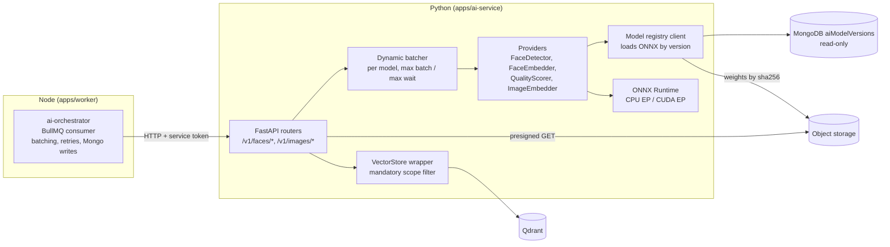
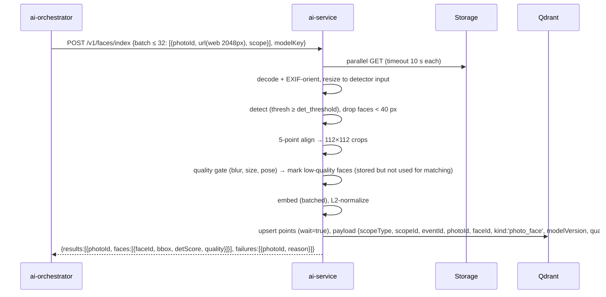
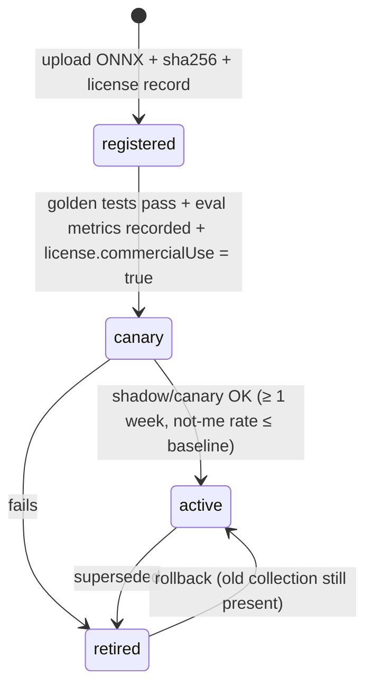

# SnapShare AI — AI Architecture

| Field | Value |
|---|---|
| Version | 0.1 (Draft, Batch 3) |
| Related | [ARCHITECTURE.md](ARCHITECTURE.md) §6.3, [DATABASE_SCHEMA.md](DATABASE_SCHEMA.md) §7/§13, [DECISIONS.md](DECISIONS.md) ADR-004/010/016 |
| Guiding constraints | 100% self-hosted inference · consent-first · **cost-first (CPU-first, GPU on demand)** |

---

## 1. Goals & non-goals

**Goals**
1. A guest finds their photos in an event from one selfie. Target: p95 under 30 s from submission when the system is warm.
2. Index every uploaded event photo for faces without a permanent GPU bill.
3. Swap models without touching business logic, and roll back in minutes.
4. Keep biometric processing provably scoped, consented, auditable and deletable.

**Non-goals (v1)**
- Video face search.
- Cross-tenant or global "find me everywhere".
- Celebrity or identity recognition against external databases.
- Emotion, age or gender inference. These are ethically risky and not needed.
- Claims of perfect accuracy. The UI always offers browsing and "Not me".

## 2. Components



| Component | Responsibility | Never does |
|---|---|---|
| ai-orchestrator (Node) | Pulls jobs, groups them into batches, presigns image URLs, calls ai-service, writes `faceDetections`, `faceMatches`, `aiJobs` and photo counters, emits events | Touch vectors or Qdrant |
| ai-service (FastAPI) | Download → decode → detect → align → embed → upsert or search Qdrant → delete temporary selfies | Business authorization decisions (it trusts only the signed scope in the request) or Mongo writes |
| Qdrant | Vector storage and search | Exposed outside the private network |

## 3. Provider abstraction (model-agnostic)

```python
# apps/ai-service/app/providers/base.py  (illustrative contract)
class FaceDetector(Protocol):
    model_version: str
    def detect(self, images: list[np.ndarray]) -> list[list[DetectedFace]]: ...
    # DetectedFace: bbox (normalized), landmarks5, det_score

class FaceEmbedder(Protocol):
    model_version: str
    dim: int
    def embed(self, aligned_crops: list[np.ndarray]) -> np.ndarray: ...   # (N, dim), L2-normalized

class QualityScorer(Protocol):
    def score(self, images: list[np.ndarray]) -> list[Quality]: ...       # blur, exposure, face_size

class ImageEmbedder(Protocol):   # Phase 7+, semantic search
    def embed_images(self, images) -> np.ndarray: ...
    def embed_text(self, texts: list[str]) -> np.ndarray: ...
```

- **Implementations** are plugins chosen by the registry key, for example `face-detector → yunet-2023mar`, `face-embedder → sface-2021dec`, or later `scrfd-10g`, `arcface-r100`.
- **Business code knows only `modelKey: 'face'`.** The active versions are resolved from `aiModelVersions`.
- **Each provider ships with its preprocessing** (input size, normalization, alignment template) and a **golden test**: fixed input images, expected embedding cosine within 1e-3. This catches broken exports.

## 4. Model selection & licensing

> ⚠️ **This is the main pre-launch blocker.** The best-known open face recognition weights are **not licensed for commercial use**. Every model must have `license.commercialUse = true`, verified by a person, before the registry allows production activation (DATABASE_SCHEMA §7).

| Candidate | Role | Licence status (verify before use) | CPU cost | Accuracy | Recommendation |
|---|---|---|---|---|---|
| **YuNet** (OpenCV Zoo) | Detection | OpenCV Zoo lists it under a permissive licence (to be confirmed by legal review of the model card and training data terms) | Very low (tiny model) | Good for frontal or near-frontal faces; weaker on tiny or profile faces | **Launch default (cost + licence)** |
| **SFace** (OpenCV Zoo) | Embedding (128-d) | Permissive per the OpenCV Zoo listing (confirm the training data terms) | Low | Below ArcFace-R100; acceptable for event-scoped search (small gallery per query) | **Launch default** |
| SCRFD (InsightFace) | Detection | InsightFace **pretrained weights: non-commercial research only**; a commercial licence is available from InsightFace | Medium | Strong on small faces in crowds | Upgrade path if licensed |
| ArcFace R50/R100, buffalo_l / antelopev2 (InsightFace) | Embedding (512-d) | **Non-commercial** pretrained weights; commercial licence purchasable | Medium–high (better on GPU) | State of the art | Upgrade path if licensed |
| Self-trained ArcFace on a licensed dataset | Embedding | Depends on the dataset licence; most public face datasets are non-commercial | High one-time training cost | Variable | Not recommended (cost) |
| Commercial on-prem SDKs | Both | Commercial | Per-instance fees | High | Fallback only |

**Plan (cost-first):**
1. In Phase 4, build the providers for **YuNet + SFace**. The registry and Qdrant also allow 512-d, so we aren't locked in.
2. Run an **evaluation harness** on a consented internal test set covering Indian wedding and event conditions: crowds, makeup, turbans and veils, low light. Measure TAR@FAR=1e-3 and event-level recall@K.
3. **If quality falls short**, ask the owner to approve buying an InsightFace commercial licence (the cost is a Batch 4 risk item). Switching is a registry change plus a background re-index (§8).
4. Video and semantic search (Phase 7+) need a CLIP-family model whose **weights and training data** permit commercial use. That model is chosen in Phase 7.

The table names only models, not their dimensions everywhere. The Qdrant collection dimension follows the active embedder: 128-d for SFace, 512-d for ArcFace. A model swap always means a new collection (§8).

## 5. Pipelines

### 5.1 Face indexing (event photos)


- **Input image.** The 2048 px `web` variant is used, not the original: it is about 6× less download and decode work, and small faces in crowd shots stay detectable (≥ 40 px). Phase 4 benchmarks confirm this.
- **Partial failures.** They are per photo. The orchestrator retries only the failed `photoIds`.
- **Idempotency.** `faceId = uuid5(photoId, modelVersion, faceIndex)`, so re-indexing overwrites the same points.

### 5.2 Selfie match (guest)
1. The orchestrator sends `POST /v1/faces/match` with:
   - `selfieUrl`
   - `filter: {scopeType, scopeId, eventId}`, built **only** from the server-verified gallery token
   - `modelKey`
2. ai-service:
   - detects faces and requires **exactly one** usable face; otherwise it returns `NO_FACE`, `MULTIPLE_FACES` or `LOW_QUALITY`, and the UI guides a retake;
   - embeds the face;
   - searches Qdrant with `limit=500`, the `filter`, `kind=photo_face`, `quality≥min`, and `score_threshold = model.matchThreshold`;
   - **deletes the selfie object** in `finally` and never logs pixels.
3. It returns `[{photoId, faceId, score}]`, de-duplicated per photo (best face).
4. The orchestrator maps each score to a **band**: `high ≥ T_high`, `medium ≥ T_match`, below that dropped. Only bands reach clients.
5. **Optional second pass ("query expansion")** for better recall at no extra GPU cost: take the top-3 high-confidence matched faces, average their embeddings with the selfie, and search again. This is controlled by a feature flag and evaluated in Phase 4.

### 5.3 Personal "Photos of me"
- **Enrollment.** 1–3 selfies → reference points `kind:'reference'` with `faceProfileId`. Selfies are deleted after embedding.
- **Matching.** A search restricted to `personalAlbumId ∈ albums the user can access`. The list is resolved by the API and passed as a signed filter. It runs on new uploads to those albums (incremental) and on demand.

### 5.4 Quality & duplicates (cheap, CPU-only)
- **Blur:** variance of Laplacian on the preview (OpenCV), computed in the **media worker**, not ai-service. It is cheap and doesn't need a model.
- **Exposure:** histogram clipping ratio.
- **Duplicates:** exact SHA-256 + 64-bit pHash with Hamming distance ≤ 6 inside the event (media worker).
- **Face grouping** (Phase 4+, photographer view): DBSCAN or HDBSCAN on an event's embeddings, run **inside ai-service** as a batch job. It returns only `faceId → clusterId`, never vectors.

## 6. Throughput, batching & cost model

### 6.1 Dynamic batcher
- Each model has an asyncio queue. A batch is flushed at `max_batch` (detector 16, embedder 64) or `max_wait_ms` (20 ms), whichever comes first.
- ONNX sessions are created once per process (`intra_op_num_threads` = physical cores per worker process).
- **Backpressure.** When the internal queue exceeds its limit, ai-service returns `429` with `Retry-After`. The orchestrator then reduces concurrency (AIMD).

### 6.2 Capacity planning (estimates; benchmark in Phase 4 before relying on them)
| Setup | Assumption | Photos/hour (indexing) |
|---|---|---|
| CPU worker, 8 vCPU, YuNet + SFace | ~50–150 ms per photo end to end, averaging 3–5 faces | **~25k–60k** |
| Same box, ArcFace-R100 on CPU | Embedding dominates; much slower | ~3k–8k |
| 1× NVIDIA T4/L4, SCRFD + ArcFace, batched | ~15–40 photos/s | ~50k–140k |

**What this means for cost.** A large Indian wedding produces about 5k–10k photos. At launch volumes, an 8-vCPU CPU worker indexes a whole wedding **in under 30 minutes, at ₹0 extra**. The GPU is only needed if heavier licensed models are adopted, or at peak (many weddings in the same week).

### 6.3 GPU on demand (ADR-016)
- **Trigger.** The orchestrator exports `ai_index_lag_seconds`. The autoscaler (a small script in `system-worker` that calls the provider API) **starts** a GPU node when lag exceeds 20 minutes for 5 minutes.
- **Scale-down.** The node is **stopped** after 15 idle minutes.
- **Safety.** A hard monthly GPU-hour budget lives in config. Once it is reached, scale-up stops and an alert is raised. This guards against a surprise bill.
- **Provider.** It must offer hourly billing and a start/stop API. India-region options are compared in Batch 4.

## 7. Thresholds & accuracy governance
- **Per model version** (`aiModelVersions.config`):
  - `detThreshold`
  - `minFaceSize`
  - `minQuality`
  - `matchThreshold` (T_match)
  - `highThreshold` (T_high)
- **Calibration.** On the evaluation set, `T_match` targets **FAR ≤ 1e-3 within an event**. A false match shows someone else's photo, which is a privacy harm, so precision beats recall.
- **Monitoring.**
  - "Not me" rate per model version and studio. An alert fires above 3%.
  - Match-success rate, i.e. the share of searches that return at least one result (PRD target ≥ 85%).
- **No demographic attributes are inferred.** Fairness checking uses the evaluation set's skin-tone and lighting slices and is run before any model is activated.

## 8. Model registry, rollout & rollback


- **Same embedding space** (for example a detector-only change) is a hot swap: the registry flips and the ai-service reloads its sessions.
- **New embedder** (a new vector space):
  1. Create the collection `face_embeddings__{modelVersion}`.
  2. A background re-index runs on spare capacity (low priority queue). **Re-index only events whose galleries are still active.** Expired events aren't re-indexed, which saves cost.
  3. Queries use the active version per event: `events.ai.modelVersion` is pinned at index time, so each event is searched in the space it was indexed with.
  4. Once all active events have migrated, retire the old version. Its collection is kept for 14 days so rollback stays possible.
- **Warmup.** On start, each model runs inference on dummy batches. `/ready` returns 200 only afterwards.

## 9. Privacy & biometric safeguards

| Requirement (spec §9) | Implementation |
|---|---|
| Opt-in, informed consent | Consent screen with versioned text (EN/HI) **before** selfie capture. Guests can always decline and browse instead |
| Consent version tracking | `consents.textVersion`. A text change requires re-consent before the next search |
| Revocation | `DELETE consent` → active searches stop immediately → `ai.face.delete` removes reference points + `faceMatches` (SLA 24 h, target < 5 min). Audited, with a confirmation email |
| Biometric deletion | Qdrant delete by filter (`faceProfileId`, `photoId`, `eventId`, `scopeId`) is **verified** by a follow-up count query. The job fails loudly and alerts if anything remains |
| Retention | Selfies are deleted right after embedding (1-day lifecycle backstop). Guest references: gallery expiry or 90 days. Photo faces: deleted on event expiry + 30 days, or when the studio disables AI |
| Access restrictions | Only ai-service has Qdrant access. Vectors never appear in any API response, log, trace or backup export outside the Qdrant snapshot store, which is encrypted |
| No cross-tenant matching | The VectorStore wrapper rejects a search without `scopeId` and an `eventId` or `personalAlbumId` filter. An automated test tries cross-scope searches |
| Non-biometric alternatives | Album browsing, time filters, photographer-tagged names, and semantic search (non-identity) in Phase 7 |
| Bystanders (people in photos who never consent) | Their face vectors exist only inside one event's scope. They are only compared against a **consenting searcher's** selfie, and only that searcher sees the results. They are deleted with the event's retention. The studio, as data fiduciary, enables AI per event, accepts a Data Processing Agreement, and the QR poster carries a notice. **Legal review needed** (SECURITY.md §8) |
| Encryption | Qdrant volume on an encrypted disk (LUKS or provider encryption); TLS between ai-service and Qdrant; snapshots encrypted with age/GPG before going to R2 |
| Minors | Self-declared under-18s cannot submit a selfie (PRD Q7). Guardian flow is pending owner decision |
| Audit | `consent.granted`, `consent.revoked`, `face.search`, `biometric.deleted`, `model.activated` are written to `auditLogs` |

## 10. ai-service API (internal contract)

| Endpoint | Request | Response |
|---|---|---|
| `POST /v1/faces/index` | `{modelKey, items:[{photoId, url, scope:{scopeType, scopeId, eventId?, personalAlbumId?}}]}` (≤ 32) | `{modelVersion, results:[{photoId, faces:[{faceId, bbox, detScore, quality}]}], failures:[{photoId, code}]}` |
| `POST /v1/faces/match` | `{modelKey, selfieUrl, selfieKey, filter:{scopeType, scopeId, eventId?, personalAlbumIds?}, limit≤500}` | `{status:'ok'\|'NO_FACE'\|'MULTIPLE_FACES'\|'LOW_QUALITY', matches:[{photoId, faceId, score}]}` |
| `POST /v1/faces/enroll` | `{modelKey, faceProfileId, selfies:[{url, key}], scope}` | `{status, referenceCount}` |
| `POST /v1/vectors/delete` | `{filter:{scopeId, eventId?\|photoIds?\|faceProfileId?}}` | `{deleted, remaining:0}` |
| `POST /v1/faces/cluster` | `{scopeId, eventId}` | `{clusters:[{clusterId, faceIds[]}]}` |
| `GET /v1/models` | — | Active versions, execution provider (cpu/cuda), warm state |
| `GET /health`, `/ready`, `/metrics` | — | Liveness, readiness after warmup, Prometheus |

- **Auth.** A shared HMAC service token is checked on every request, over a private network only (no public ingress).
- **Signed scopes.** The `scope`/`filter` objects are signed by the orchestrator (HMAC over canonical JSON) and verified by ai-service. A bug elsewhere can't widen a search.

## 11. Observability (AI-specific)

| Metric | Type | Alert |
|---|---|---|
| `ai_inference_seconds{model,stage,provider}` | histogram | p95 > 2× baseline for 10 min |
| `ai_batch_size{model}` | histogram | — |
| `ai_index_lag_seconds` | gauge | > 30 min (triggers GPU scale-up at 20 min) |
| `ai_jobs_failed_total{type,code}` | counter | DLQ > 0 for `face.delete` → page immediately |
| `ai_match_results{band}` / `ai_match_empty_total` | counter | Empty rate > 25% |
| `ai_notme_total{modelVersion}` | counter | > 3% of matches |
| `gpu_utilization`, `gpu_memory_used` (DCGM exporter, GPU nodes only) | gauge | — |
| `ai_gpu_hours_month` | gauge | 80% / 100% of budget |

## 12. Local development (CPU mode)
- `docker compose --profile ai up` starts ai-service (CPU image, YuNet + SFace, about 40 MB of weights) and Qdrant.
- Weights are fetched by `scripts/fetch-models.sh` from URLs and checksums listed in `infrastructure/models.lock`. They are **never committed** (.gitignore).
- **Tests.** Unit tests use a deterministic `FakeEmbedder`, **only** for tests and never as a production fallback (spec §19). Integration tests run the real CPU models on a small set of synthetic or consented test images.
