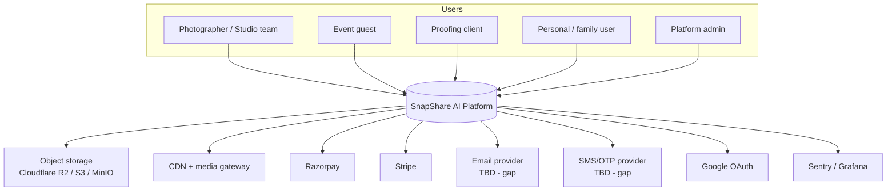
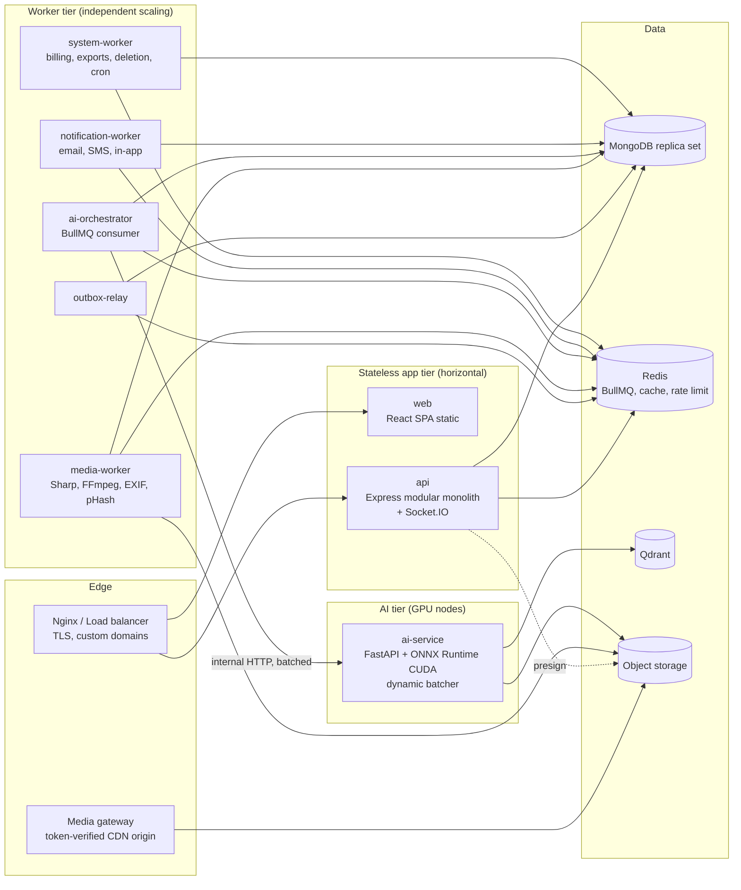
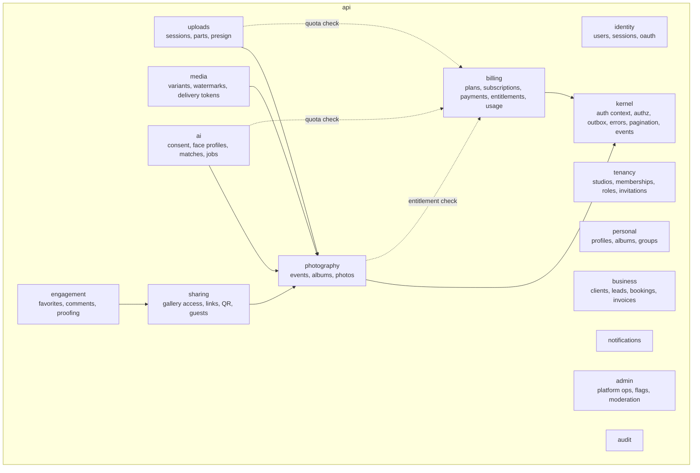
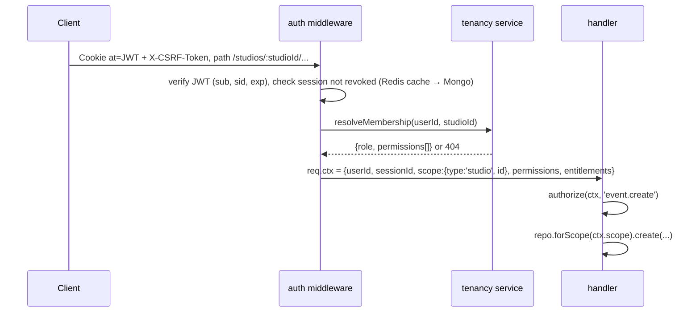
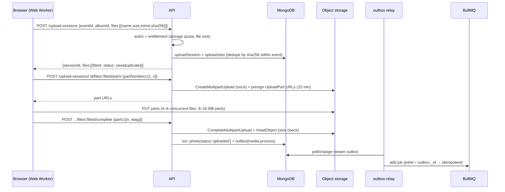
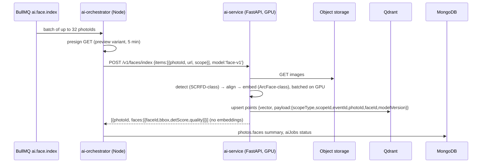

# SnapShare AI — System Architecture

| Field | Value |
|---|---|
| Version | 0.1 (Draft, Batch 2) |
| Related | [DATABASE_SCHEMA.md](DATABASE_SCHEMA.md), [API_SPEC.md](API_SPEC.md), [DECISIONS.md](DECISIONS.md) |

---

## 1. Architecture at a glance

- A **modular monolith** API (Node/Express/TS) owns all business logic. Modules talk through in-process service interfaces and **domain events**, never through each other's collections.
- **Expensive work is always asynchronous.** The API writes to MongoDB plus an **outbox** in one transaction. A relay publishes the outbox to **BullMQ** (Redis). Workers process the jobs.
- **Binaries never touch the API.** Browsers upload straight to object storage (R2/S3/MinIO) with presigned multipart URLs. Media is served through a CDN with short-lived signed tokens.
- **AI runs in its own service** (Python/FastAPI, ONNX Runtime, CUDA). It is the **only** component that can read or write **Qdrant**. Embeddings never leave the AI service except to Qdrant.
- **Every request is stateless.** Sessions live in MongoDB, rate limits and caches in Redis, and Socket.IO scales through the Redis adapter.

## 2. System context (C4 level 1)



Only payments, email/SMS, OAuth and error reporting are external. **No AI inference leaves our infrastructure.**

## 3. Containers (C4 level 2)



| Deployable | Tech | Scales on | State |
|---|---|---|---|
| `web` | Vite build served by Nginx/CDN | — (static) | none |
| `api` | Node 22, Express 5, Socket.IO | CPU / RPS | none (stateless) |
| `outbox-relay` | Node | 1–2 replicas, leader-elected via a Redis lock | none |
| `media-worker` | Node + Sharp (libvips) + FFmpeg | `media.*` queue depth | none |
| `ai-orchestrator` | Node BullMQ consumer | `ai.*` queue depth | none |
| `ai-service` | Python 3.12, FastAPI, ONNX Runtime GPU | GPU utilization | models in memory |
| `notification-worker` | Node | `notify.*` depth | none |
| `system-worker` | Node (cron + jobs) | low | none |

In the repo layout (spec §17), `apps/worker` builds one image with several **entrypoints** (`relay`, `media`, `ai`, `notify`, `system`) so each pool deploys and scales separately. `apps/ai-service` is its own Python image with CPU and CUDA build targets.

## 4. API modular monolith — module map



**Module rules** (enforced with an ESLint `boundaries` rule in Phase 1):
1. Each module has `routes/ → controllers/ → services/ → repositories/ → models/`. Other modules may import **only** from its `index.ts` public API.
2. A module's Mongoose models are private. Cross-module reads go through the owning module's service.
3. Side effects across modules go through domain events, for example `photo.uploaded` → media, `photo.processed` → ai, `subscription.changed` → entitlements cache.
4. `kernel` holds cross-cutting code: `AuthContext`, the `authorize()` policy engine, the scoped repository base, the outbox writer, errors (RFC 9457), cursor pagination, logging and tracing.

Folder sketch:
```
apps/api/src/
  kernel/            auth-context.ts, authorize.ts, scoped-repo.ts, outbox.ts, errors.ts ...
  modules/
    identity/  tenancy/  personal/  photography/  uploads/  media/  ai/
    sharing/   engagement/  business/  billing/  notifications/  admin/  audit/
  app.ts  server.ts  socket.ts
```

## 5. Tenancy & authorization model

### 5.1 Scopes
Every owned resource carries a **scope**:

| `scopeType` | `scopeId` | Who |
|---|---|---|
| `studio` | `studios._id` (this is the spec's `tenantId`) | Studio members, according to their role |
| `personal` | `users._id` of the owner | The owner, plus group members through explicit grants |

Studio-only collections (events, clients, bookings and so on) use a plain `tenantId`. Collections shared by both experiences (photos, uploads, faces, favorites and so on) use `scopeType + scopeId`. See ADR-007.

### 5.2 Request auth context


- The **`studioId` in the URL is only a selector.** The server resolves membership, and a non-member gets **404, not 403**, so the response doesn't reveal that the studio exists.
- **Scoped repositories.** `ScopedRepository.forScope(scope)` injects `{scopeType, scopeId}` (or `tenantId`) into every query, update and delete. Raw `Model.find()` is banned outside repositories by a lint rule. **Tenant isolation tests** run in CI for every route (TESTING.md, Batch 3).
- **Permissions** are strings such as `event.create`, `photo.delete` and `billing.manage`. Roles map to permission sets (`roles` collection, with system roles seeded). Route handlers check permissions, never role names.
- **Entitlements** are resolved from the plan, then add-ons, then overrides, and cached in Redis per scope (TTL 5 minutes, cleared on `subscription.changed`). The cache answers `can(feature)` and `limit(metric)`.

### 5.3 Guest and client access
Public galleries don't use user sessions. A **gallery access grant** works like this:
1. `GET /public/galleries/:code` resolves the share link and checks its expiry and status.
2. If a PIN, OTP or invite is required, the guest verifies it and the server issues a **gallery token**: a JWT signed with a separate key and scoped to `{shareLinkId, eventId, albumIds?, permissions:[view,download,favorite], guestId?}`, valid for 12 hours, stored in an HTTP-only cookie at path `/api/v1/public`.
3. Every public endpoint checks the gallery token against the requested resource. A photo ID from another event returns 404.

Proofing clients get a **proofing token** the same way, scoped to one proofing set.

## 6. Key flows

### 6.1 Upload (direct to storage, resumable)


- **Resume.** On reload, the client calls `GET /upload-sessions/:id`. The server returns the parts already stored (from `uploadParts` or `ListParts`), and the client uploads only the missing ones.
- **Single PUT for small files.** Files under 8 MB skip multipart.
- **Object keys** are immutable and never reused:
  `{scopeType}/{scopeId}/{eventId|albumId}/{photoId}/original.{ext}`
  Variants sit beside the original: `thumb.webp`, `preview.webp`, `web.jpg`, `wm-preview.webp`.
- **Abandoned uploads.** A storage lifecycle rule aborts incomplete multipart uploads after 7 days. The system worker expires stale sessions.

### 6.2 Media processing
`media.process(photoId)` runs these steps:
1. Download the original as a stream.
2. **Verify the MIME type** from magic bytes, not from the extension.
3. Extract EXIF (taken-at, camera, orientation, GPS). GPS is **stripped from derivatives** and stored only if the studio enables it.
4. Auto-orient the image.
5. Compute a pHash and check near-duplicates within the event.
6. Generate the variants with Sharp. Video goes through an FFmpeg poster and HLS (Phase 3b).
7. Apply the watermark preset to `wm-preview`.
8. Upload the variants and update `photos` and `photoVariants`.
9. Emit `photo.processed`.
10. If the event has AI enabled and the AI quota allows, write an outbox `ai.face.index` job.

**Idempotency.** Each step checks `processing.steps[step].done`. Re-running a job overwrites the variants with identical output and never touches the original.

### 6.3 AI indexing and matching


**Guest selfie match** (asynchronous; never inside the API request):
1. The guest has consent and a gallery token. They upload a selfie to a temporary key `tmp/selfies/{uuid}.jpg`, which has a 1-day lifecycle rule.
2. The API creates an `aiJobs{type:'face.match'}` record with an outbox entry and returns `202 {jobId}`.
3. The orchestrator calls `POST /v1/faces/match`. The ai-service:
   - embeds the selfie;
   - searches Qdrant with a **mandatory filter** `{scopeType, scopeId, eventId}`;
   - applies the threshold for that model version;
   - **deletes the selfie object**;
   - returns `[{photoId, score}]`.
4. Results go to `faceMatches`. The guest is notified over Socket.IO in the `aiJob:{jobId}` room.

The filter is built server-side from the gallery token, and the ai-service **rejects any search without a scope filter**.

Batch 3 (AI_ARCHITECTURE.md) details the models, batching, thresholds and registry.

### 6.4 Outbox pattern
- `outbox` documents are written **in the same MongoDB transaction** as the state change: `{_id, topic, payload, status:'pending', attempts, availableAt}`.
- The `outbox-relay` tails a MongoDB **change stream**, with a polling fallback. It calls `queue.add(topic, payload, {jobId: outbox._id})`, so BullMQ deduplicates by jobId. Then it marks the entry `published`.
- Published entries get a TTL index and are deleted after 7 days.
- **At-least-once delivery.** Consumers are idempotent: they check state before acting.

### 6.5 Queues

| Queue | Producer | Consumer | Concurrency (start) | Retries | DLQ |
|---|---|---|---|---|---|
| `media.process` | relay | media-worker | 4 per pod | 5, exponential (30 s → 30 min) | `media.dlq` |
| `media.video` | relay | media-worker (video pool) | 1 per pod | 3 | `media.dlq` |
| `ai.face.index` | relay | ai-orchestrator | 2 batches in flight per GPU | 5 | `ai.dlq` |
| `ai.face.match` | relay | ai-orchestrator (priority queue) | 8 | 3 | `ai.dlq` |
| `ai.face.delete` | relay | ai-orchestrator | 4 | 10 | `ai.dlq` (alerts) |
| `notify.email` / `notify.sms` / `notify.inapp` | relay | notification-worker | 20 | 5 | `notify.dlq` |
| `export.zip` | relay | system-worker | 2 | 3 | `system.dlq` |
| `deletion.cascade` | relay | system-worker | 2 | 10 | `system.dlq` (alerts) |
| `billing.webhook` | API (after signature check) | system-worker | 4 | 8 | `billing.dlq` (alerts) |
| `cron.*` | BullMQ repeatable jobs | system-worker | 1 | — | — |

- **DLQ.** A job that exhausts its retries is copied to the `*.dlq` queue. The source record is marked `failed` with the reason, an alert fires, and admins can retry from AD-30 (USER_JOURNEYS J9).
- **No uncontrolled background jobs.** Every job type is registered in `packages/config/queues.ts` with its retry policy, timeout and owner module.
- **Fairness.** One studio uploading 50,000 photos must not starve everyone else. The `ai.face.index` and `media.process` queues use **BullMQ groups per scopeId**, or a per-tenant round-robin producer if the Pro feature isn't used. ADR-005 records this.

### 6.6 Media delivery
- Private media is never public in the bucket.
- The API returns **delivery URLs** of the form `https://media.snapshare.in/{key}?t=<token>`. The token is an HMAC over `{keyPrefix, exp, variantSet}` with a lifetime of about 1 hour for galleries.
- The **media gateway** checks the token and then serves from the CDN cache or the origin bucket. The cache key ignores the token, so a gallery seen by 5,000 guests is cached once.
- Recommended implementation: a Cloudflare Worker in front of R2. For self-hosted or S3, Nginx `secure_link` with `proxy_cache` in front of S3/MinIO works instead. The ARCHITECTURAL_GAPS doc (Batch 4) carries the owner decision.
- **Originals and zip downloads** use direct presigned GETs (5 minutes, `Content-Disposition: attachment`) issued only after a download-permission check. Each download is logged.

### 6.7 Real-time (Socket.IO)
- Socket.IO uses the Redis adapter, so any API pod can emit to any room.
- **Rooms:**
  - `user:{id}`
  - `scope:{type}:{id}` for studio-wide upload and processing progress
  - `event:{id}:uploads`
  - `aiJob:{id}`
  - `proofing:{setId}`
- **Join rules.** The server authorizes every room join. A room name sent by the client is only a request.
- **Throttling.** Workers publish progress through Redis pub/sub. Processing progress is throttled to one batch per second per room.

### 6.8 Custom domains (Phase 8)
- **Routing.** A studio CNAMEs `gallery.studio.com` to `custom.snapshare.in`. Nginx (or Caddy, chosen at Phase 8) issues TLS on demand once the domain is verified in `customDomains`.
- **Same origin.** API calls from a custom domain go to `https://gallery.studio.com/api/v1/public/*`, which is proxied. Requests stay same-origin, so cookies work without third-party cookie problems.

## 7. Cross-cutting concerns

| Concern | Approach |
|---|---|
| Validation | Zod schemas in `packages/validators`, shared by web and api; OpenAPI generated from Zod (`zod-openapi`) |
| Errors | RFC 9457 `application/problem+json` with stable `code` values |
| Logging | pino JSON with `traceId`, `scope`, `userId`; no PII in logs |
| Tracing | OpenTelemetry SDK in api, workers and ai-service; traces cross the HTTP→BullMQ→ai-service boundary through job data |
| Metrics | Prometheus `/metrics` on every service (internal port only) |
| Config | `packages/config` with env-validated (Zod) config; secrets from env or a secret manager |
| Feature flags | `featureFlags` collection, evaluated in the API and exposed to the web via `/me/flags`; per plan, tenant or user; cached in Redis |
| Audit | `audit.record(ctx, action, target, diff?)` in the same transaction as the change for security-sensitive actions |
| Rate limiting | Redis sliding window; per IP, user, scope and route class (auth, OTP, PIN, upload presign, public gallery) |
| i18n | `react-i18next`; English first, Hindi strings for consent and legal |
| Time | Stored as UTC; displayed in the studio's timezone (default `Asia/Kolkata`) |

## 8. Scalability path

| Load | Plan |
|---|---|
| Launch (≤ 500 studios) | Single region (Mumbai, `ap-south-1` or equivalent). 2 api pods, 2 media workers, 1 GPU node (L4/T4), Mongo 3-node replica set, Redis primary + replica, Qdrant single node with snapshots |
| 10k studios | api 6–10 pods behind the LB; media pool autoscales on queue depth; 2–6 GPU nodes autoscale on `ai.face.index` lag; Mongo on larger nodes with read preference for analytics; Qdrant 3-node cluster with collection sharding by `scopeId` hash and replication factor 2 |
| Beyond | Mongo sharding (shard key `{scopeId:1,_id:1}` on photos, faceMatches and favorites); separate the analytics store (ClickHouse) from Mongo; consider extracting `ai` and `media` modules into services |

**Hot paths and their indexes:**
- Gallery browsing uses `photos{scopeId, eventId, albumId, status, takenAt}` with cursor pagination.
- Match results come from `faceMatches{eventId, guestId}`.

Batch 2's DATABASE_SCHEMA.md defines every index.

## 9. Environments

| Env | Purpose | AI |
|---|---|---|
| `local` | Docker Compose: mongo (single-node replica set for transactions), redis, qdrant, minio, mailpit, api, web, workers, ai-service | CPU ONNX, small models |
| `ci` | Ephemeral Compose; tenant isolation and contract tests | CPU, stub provider for unit tests only |
| `staging` | Production-like, smaller sizes | 1 GPU (spot or shared) |
| `production` | See INFRASTRUCTURE.md (Batch 3) | Dedicated GPU pool |
