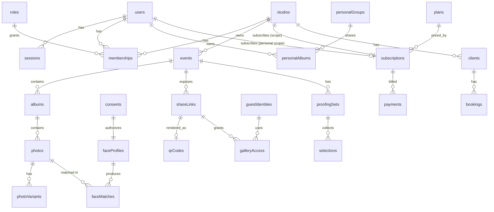

# SnapShare AI — Database Schema

| Field | Value |
|---|---|
| Version | 0.1 (Draft, Batch 2) |
| Databases | MongoDB 7+ (replica set; transactions required), Qdrant 1.x |
| Related | [ARCHITECTURE.md](ARCHITECTURE.md) §5, [DECISIONS.md](DECISIONS.md) |

## 0. Conventions

- **IDs** are `ObjectId`. Public, URL-visible codes such as share codes are separate random strings (base62, ≥ 10 chars), never ObjectIds.
- **Timestamps:** every document has `createdAt` and `updatedAt` (Mongoose `timestamps`), stored in UTC.
- **Scope fields:**
  - Studio-only collections use `tenantId: ObjectId → studios`.
  - Collections shared by both experiences use `scopeType: 'studio'|'personal'` + `scopeId: ObjectId`. When `scopeType` is `studio`, `scopeId` is the tenantId; when it is `personal`, `scopeId` is the owner's `users._id`.
  - **The first key of every index on a scoped collection is the scope key.** This keeps queries tenant-bounded and enables future sharding.
- **Soft delete:** `deletedAt?: Date` on user-facing content (events, albums, photos). Purge jobs hard-delete after the retention period. Biometric data is **never** soft deleted; it is hard deleted.
- **Pagination:** cursor-based on `(sortKey, _id)`. Offset pagination is not used on large collections.
- **Money:** integer minor units (`amountMinor`, paise) plus an ISO `currency`.
- **Schema versioning:** a `schemaVersion: number` field on documents likely to migrate (photos, subscriptions, plans).
- **Legend:** 🔒 = sensitive or PII, ⏳ = TTL or retention-managed, ➕ = collection added beyond MASTER_SPEC §10 (needs approval).

## 1. Entity relationships (core)



---

## 2. Identity

### `users` 🔒
| Field | Type | Notes |
|---|---|---|
| email | string | lowercase, unique |
| emailVerifiedAt | Date? | |
| passwordHash | string? | argon2id; null for OAuth-only accounts |
| name | string | |
| phone | string? | E.164; `phoneVerifiedAt?` |
| avatarKey | string? | object storage key |
| oauth | `[{provider:'google', subject, linkedAt}]` | |
| platformRole | `'none'\|'support'\|'admin'` | super-admin access |
| mfa | `{totpSecretEnc?, enabledAt?}` | required when platformRole ≠ none |
| status | `'active'\|'suspended'\|'pending_deletion'\|'deleted'` | |
| deletionRequestedAt | Date? | 7-day grace period |
| locale, timezone | string | defaults `en`, `Asia/Kolkata` |
| failedLogin | `{count, lockedUntil?}` | brute-force protection |

Indexes: `{email:1}` unique · `{'oauth.provider':1,'oauth.subject':1}` unique sparse · `{status:1, deletionRequestedAt:1}`

```json
{ "_id": "665f...a1", "email": "rohan@lensstory.in", "emailVerifiedAt": "2026-11-20T10:00:00Z",
  "passwordHash": "$argon2id$v=19$...", "name": "Rohan Verma", "platformRole": "none",
  "status": "active", "locale": "en", "timezone": "Asia/Kolkata" }
```

### `sessions`
One document per logged-in device.
| Field | Type | Notes |
|---|---|---|
| userId | ObjectId | |
| device | `{ua, os, browser, ipHash, approxLocation?}` | IP is stored as a salted hash |
| createdAt, lastSeenAt | Date | |
| expiresAt | Date | ⏳ 30 days idle / 90 days absolute |
| revokedAt | Date? | Revoked IDs are cached in Redis until the access token expires |
| mfaVerifiedAt | Date? | Admin sessions |

Indexes: `{userId:1, revokedAt:1}` · `{expiresAt:1}` TTL

### `refreshTokens`
Rotating tokens with family reuse detection.
| Field | Type | Notes |
|---|---|---|
| sessionId, userId | ObjectId | |
| tokenHash | string | SHA-256 of the opaque token |
| familyId | string | If a used token is presented again, the whole family and its session are revoked |
| usedAt | Date? | |
| expiresAt | Date | ⏳ |

Indexes: `{tokenHash:1}` unique · `{familyId:1}` · `{expiresAt:1}` TTL

### `verificationTokens` ⏳
| Field | Type | Notes |
|---|---|---|
| purpose | `'email_verify'\|'password_reset'\|'email_change'\|'otp_guest'\|'otp_phone'` | |
| subject | `{userId?, email?, phone?}` | |
| tokenHash | string | |
| attempts | number | Locked after 5 (OTP) |
| expiresAt | Date | 15 min (OTP), 1 h (reset), 24 h (verify) |
| consumedAt | Date? | |

Indexes: `{tokenHash:1}` unique · `{purpose:1,'subject.email':1}` · `{expiresAt:1}` TTL

---

## 3. Tenancy

### `studios`
| Field | Type | Notes |
|---|---|---|
| name, slug | string | `slug` unique; reserved words blocked |
| ownerUserId | ObjectId | Denormalized; source of truth is the memberships with role owner |
| branding | `{logoKey?, primaryColor?, accentColor?, font?, hideSnapshareBadge}` | Entitlement-gated |
| contact | `{email, phone, website?, instagram?, address?}` | |
| billingProfile 🔒 | `{legalName, gstin?, stateCode, address}` | GST invoices |
| settings | `{defaultWatermarkPresetId?, defaultGalleryExpiryDays, stripGps:true, aiDefaultEnabled}` | |
| status | `'active'\|'suspended'\|'pending_deletion'` | |
| usage | `{storageBytes, photoCount, activeEvents, seats}` | Counters, reconciled nightly from usageRecords |

Indexes: `{slug:1}` unique · `{ownerUserId:1}` · `{status:1}`

### `roles`
| Field | Type | Notes |
|---|---|---|
| tenantId | ObjectId? | null = system role |
| key | string | `owner`, `admin`, `editor`, `uploader`, `viewer`, or custom |
| name | string | |
| permissions | string[] | e.g. `event.create`, `photo.upload`, `billing.manage` |
| system | boolean | System roles are immutable |

Indexes: `{tenantId:1, key:1}` unique

**System role → permission matrix** (summary; the full matrix is seeded in Phase 2):

| Permission group | owner | admin | editor | uploader | viewer |
|---|---|---|---|---|---|
| studio.settings / branding | ✅ | ✅ | — | — | — |
| billing.* | ✅ | view | — | — | — |
| team.manage | ✅ | ✅ (not owners) | — | — | — |
| event.create/update/delete | ✅ | ✅ | ✅ (no delete) | — | — |
| photo.upload | ✅ | ✅ | ✅ | ✅ | — |
| photo.delete/hide | ✅ | ✅ | ✅ | own uploads | — |
| share.manage / proofing.manage | ✅ | ✅ | ✅ | — | — |
| ai.settings | ✅ | ✅ | — | — | — |
| crm.* | ✅ | ✅ | view | — | — |
| analytics.view / audit.view | ✅ | ✅ | — | — | — |
| *.read (events, photos) | ✅ | ✅ | ✅ | ✅ | ✅ |

### `memberships`
| Field | Type | Notes |
|---|---|---|
| tenantId, userId | ObjectId | |
| roleId | ObjectId | |
| status | `'active'\|'suspended'` | |
| invitedBy | ObjectId? | |

Indexes: `{tenantId:1, userId:1}` unique · `{userId:1, status:1}` (workspace switcher)

### `invitations` ⏳
Covers studio team, personal group, proofing client and event guest invitations.
| Field | Type | Notes |
|---|---|---|
| kind | `'studio_member'\|'group_member'\|'proofing_client'\|'event_guest'` | |
| target | `{tenantId?, groupId?, proofingSetId?, eventId?}` | |
| email?, phone? | string | |
| roleKey | string | |
| tokenHash | string | |
| invitedBy | ObjectId | |
| status | `'pending'\|'accepted'\|'revoked'\|'expired'` | |
| expiresAt | Date | 7 days default |

Indexes: `{tokenHash:1}` unique · `{'target.tenantId':1, status:1}` · `{email:1, status:1}`

---

## 4. Personal

### `personalProfiles`
| Field | Type | Notes |
|---|---|---|
| userId | ObjectId | unique |
| usage | `{storageBytes, photoCount}` | |
| settings | `{autoMatchEventPhotos:boolean}` | Requires consent |

### `personalGroups` ➕
Groups were needed for family and group sharing but are missing from spec §10.
| Field | Type | Notes |
|---|---|---|
| ownerUserId | ObjectId | Storage is billed to the owner |
| name, kind | string, `'family'\|'friends'\|'other'` | |
| members | `[{userId, role:'owner'\|'contributor'\|'viewer', joinedAt}]` | Capped by entitlement (default ≤ 50) |

Indexes: `{'members.userId':1}` · `{ownerUserId:1}`

### `personalAlbums`
| Field | Type | Notes |
|---|---|---|
| ownerUserId | ObjectId | Scope id |
| title, coverPhotoId? | | |
| sharedWith | `{groupIds:[ObjectId], userIds:[{userId, role}]}` | |
| visibility | `'private'\|'shared'\|'link'` | |
| counts | `{photos, bytes}` | |
| deletedAt | Date? | |

Indexes: `{ownerUserId:1, deletedAt:1, updatedAt:-1}` · `{'sharedWith.groupIds':1}` · `{'sharedWith.userIds.userId':1}`

---

## 5. Photography

### `events` (studio only)
| Field | Type | Notes |
|---|---|---|
| tenantId | ObjectId | |
| name, type | string, `'wedding'\|'corporate'\|'birthday'\|'festival'\|'other'` | |
| startsAt, endsAt?, venue? | | |
| coverPhotoId? | ObjectId | |
| clientId? | ObjectId | CRM link |
| status | `'draft'\|'active'\|'archived'` | |
| gallery | `{visibility:'private'\|'link'\|'invite', pinHash?, expiresAt?, download:{enabled, originals:boolean, watermarked:boolean}, themeId?, layout:'masonry'\|'grid'}` | |
| ai | `{enabled:boolean, consentTextVersion, faceRetentionDays:90, modelKey:'face'}` | |
| watermarkPresetId? | ObjectId | |
| counts | `{photos, processed, failed, indexedFaces, bytes, videos}` | |
| deletedAt? | Date | |

Indexes: `{tenantId:1, deletedAt:1, startsAt:-1}` · `{tenantId:1, status:1}`

```json
{ "_id": "6660...e1", "tenantId": "6650...s1", "name": "Ananya & Kabir Wedding", "type": "wedding",
  "startsAt": "2026-12-12T06:30:00Z", "venue": "Rambagh Palace, Jaipur", "status": "active",
  "gallery": { "visibility": "link", "expiresAt": "2027-03-12T00:00:00Z",
               "download": { "enabled": true, "originals": false, "watermarked": true }, "layout": "masonry" },
  "ai": { "enabled": true, "consentTextVersion": "2026-11-v1", "faceRetentionDays": 90, "modelKey": "face" },
  "counts": { "photos": 5120, "processed": 5118, "failed": 2, "indexedFaces": 21450, "bytes": 61203947520 } }
```

### `albums` (studio only; sub-albums inside an event)
| Field | Type | Notes |
|---|---|---|
| tenantId, eventId | ObjectId | |
| name, slug, sortOrder | | |
| visibility | `'visible'\|'hidden'` | Hidden = photographer only |
| coverPhotoId?, counts | | |

Indexes: `{tenantId:1, eventId:1, sortOrder:1}`

### `photos`
Shared by both scopes; the hottest collection.
| Field | Type | Notes |
|---|---|---|
| scopeType, scopeId | | |
| eventId?, albumId? | ObjectId | Studio |
| personalAlbumId? | ObjectId | Personal |
| uploaderUserId | ObjectId | |
| mediaType | `'image'\|'video'` | |
| original | `{key, bytes, mime, width, height, sha256, filename}` | Key is immutable |
| variants | `{thumb:{key,w,h}, preview:{...}, web:{...}, wmPreview?:{...}, poster?:{...}, hls?:{key}}` | Denormalized summary for fast gallery reads |
| exif | `{takenAt?, camera?, lens?, iso?, focal?, gps?🔒}` | GPS kept only if the studio enables it |
| phash | string | 64-bit hex |
| duplicateOf? | ObjectId | |
| quality | `{blur?, exposure?, score?}` | AI (Phase 4+) |
| faces | `{count, indexedAt?, modelVersion?}` | **No embeddings or bounding boxes here.** Boxes are in `faceDetections` |
| status | `'uploading'\|'uploaded'\|'processing'\|'ready'\|'failed'` | |
| processing | `{attempts, lastError?, steps:{exif,variants,watermark,ai}}` | |
| visibility | `'visible'\|'hidden'` | |
| sortKey | Date | `takenAt ?? createdAt` |
| deletedAt? | Date | |

Indexes:
- `{scopeId:1, eventId:1, albumId:1, status:1, sortKey:1, _id:1}`: gallery pagination
- `{scopeId:1, personalAlbumId:1, sortKey:-1, _id:-1}`
- `{scopeId:1, eventId:1, 'original.sha256':1}` unique (partial: `deletedAt` missing): exact-duplicate detection
- `{scopeId:1, eventId:1, phash:1}`
- `{status:1, updatedAt:1}`: stuck-job sweeper
- `{deletedAt:1}` partial: purge job

### `photoVariants`
Full record for each derivative, used for lifecycle, regeneration and storage accounting.
| Field | Type | Notes |
|---|---|---|
| scopeType, scopeId, photoId | | |
| kind | `'thumb'\|'preview'\|'web'\|'wm_preview'\|'poster'\|'hls'` | |
| key, bytes, width, height, format | | |
| params | `{quality, watermarkPresetId?, pipelineVersion}` | Lets us regenerate when the pipeline changes |

Indexes: `{photoId:1, kind:1}` unique · `{scopeId:1, kind:1}`

### `watermarkPresets` ➕
| Field | Type | Notes |
|---|---|---|
| tenantId | ObjectId | |
| name, type | `'image'\|'text'` | |
| imageKey?, text?, position, opacity, scalePct, tile:boolean | | |

Indexes: `{tenantId:1}`

---

## 6. Uploads

### `uploadSessions` ⏳
| Field | Type | Notes |
|---|---|---|
| scopeType, scopeId, userId | | |
| target | `{eventId?, albumId?, personalAlbumId?}` | |
| totals | `{files, bytes, completed, failed, duplicates}` | |
| status | `'open'\|'completed'\|'cancelled'\|'expired'` | |
| expiresAt | Date | 7 days |

Indexes: `{scopeId:1, userId:1, status:1}` · `{expiresAt:1}` (sweeper; not TTL, because the sweeper also aborts multipart uploads)

### `uploadJobs`
One document per file in a session.
| Field | Type | Notes |
|---|---|---|
| sessionId, scopeId | | |
| clientFileId | string | Client-generated UUID for resume |
| filename, bytes, mime, sha256 | | Declared by the client and **re-verified** by the media worker |
| photoId? | ObjectId | Created on complete |
| storage | `{key, uploadId?, partSize, totalParts}` | `uploadId` = S3 multipart id |
| status | `'pending'\|'uploading'\|'completed'\|'duplicate'\|'failed'\|'cancelled'` | |
| error? | string | |

Indexes: `{sessionId:1, clientFileId:1}` unique · `{sessionId:1, status:1}`

### `uploadParts` ⏳
| Field | Type | Notes |
|---|---|---|
| uploadJobId | ObjectId | |
| partNumber, etag, bytes | | |

Indexes: `{uploadJobId:1, partNumber:1}` unique. Deleted when the upload job completes.

---

## 7. AI & Consent

### `consents` ➕ 🔒
Spec §9 requires consent version tracking; this is the system of record.
| Field | Type | Notes |
|---|---|---|
| subject | `{userId?, guestId?}` | |
| purpose | `'face_match'` | Room for other purposes later |
| scope | `{type:'event'\|'studio'\|'personal', id}` | Personal consent covers the user's own and shared albums |
| textVersion | string | e.g. `2026-11-v1` |
| locale | string | Language the user saw |
| grantedAt | Date | |
| method | `'checkbox'` | |
| evidence | `{ipHash, uaHash}` | |
| isMinorFlow | boolean | Guardian consent (pending owner decision) |
| revokedAt? | Date | |
| expiresAt? | Date | |

Indexes: `{'subject.userId':1, purpose:1, revokedAt:1}` · `{'subject.guestId':1}` · `{'scope.id':1, revokedAt:1}`

Retention: consent records are kept for **6 years after revocation**, without biometric data, as compliance evidence. This period needs legal review.

### `faceProfiles` 🔒
An enrolled person's reference identity. **No vectors are stored in MongoDB.**
| Field | Type | Notes |
|---|---|---|
| subject | `{userId?, guestId?}` | |
| consentId | ObjectId | Required; the profile is deleted if consent is revoked |
| scope | `{type, id}` | Same as the consent |
| qdrantPointIds | string[] | Reference embedding points in `face_embeddings` (kind=reference) |
| modelVersion | string | |
| status | `'active'\|'pending_deletion'\|'deleted'` | |
| expiresAt | Date | From retention policy |

Indexes: `{'subject.userId':1, 'scope.id':1}` · `{'subject.guestId':1}` · `{expiresAt:1}` (deletion sweeper)

### `faceDetections` ➕
Faces detected in photos. Kept separate from `photos` to keep photo documents small.
| Field | Type | Notes |
|---|---|---|
| scopeType, scopeId, eventId?, photoId | | |
| faceId | string | UUID; equals the Qdrant point id |
| bbox | `[x,y,w,h]` normalized | |
| detScore, quality | number | |
| modelVersion | string | |
| clusterId? | string | Face grouping (Phase 4+) |

Indexes: `{scopeId:1, photoId:1}` · `{scopeId:1, eventId:1, clusterId:1}` · `{faceId:1}` unique

### `faceMatches`
| Field | Type | Notes |
|---|---|---|
| scopeType, scopeId, eventId? | | |
| subject | `{userId?, guestId?}` | |
| faceProfileId? / aiJobId | ObjectId | |
| photoId, faceId | | |
| score | number | Server-side only. **Not exposed to clients** except as a confidence band |
| status | `'matched'\|'rejected_by_user'` | "Not me" feedback |
| modelVersion | string | |

Indexes: `{scopeId:1, eventId:1, 'subject.guestId':1, status:1}` · `{'subject.userId':1, status:1, createdAt:-1}` · `{photoId:1}` (cascade delete)

### `aiJobs`
Business-level status of AI work. BullMQ holds the transport state.
| Field | Type | Notes |
|---|---|---|
| scopeType, scopeId | | |
| type | `'face.index'\|'face.match'\|'face.delete'\|'image.embed'\|'quality.score'\|'face.cluster'` | |
| input | `{photoIds?, selfieKey?, faceProfileId?, eventId?}` | `selfieKey` is cleared once processed |
| status | `'queued'\|'running'\|'succeeded'\|'failed'\|'dead'` | |
| attempts, error? | | |
| modelVersion, durationMs, gpuNode? | | Monitoring |

Indexes: `{scopeId:1, type:1, createdAt:-1}` · `{status:1, createdAt:1}` · TTL on `createdAt` (90 days) for `succeeded` jobs, via a partial TTL index

### `aiModelVersions`
| Field | Type | Notes |
|---|---|---|
| key | `'face-detector'\|'face-embedder'\|'image-embedder'\|'quality'` | |
| version | string | e.g. `scrfd-10g-v1` |
| artifact | `{uri, sha256, format:'onnx', inputSize}` | Weights in private storage |
| license | `{name, commercialUse:boolean, verifiedBy, verifiedAt, docUrl}` | **Must be `commercialUse: true` before it can be activated in production** |
| config | `{detThreshold, matchThreshold, nms, embeddingDim, distance:'cosine'}` | |
| status | `'registered'\|'canary'\|'active'\|'retired'` | |
| metrics | `{tarAtFar1e3?, latencyMsP95?}` | From evaluation runs |

Indexes: `{key:1, version:1}` unique · `{key:1, status:1}`

---

## 8. Sharing

### `shareLinks`
| Field | Type | Notes |
|---|---|---|
| tenantId?, scopeType, scopeId | | Personal albums can also have links |
| target | `{eventId?, albumIds?, personalAlbumId?, proofingSetId?}` | |
| code | string | Random base62, 10+ characters, unique |
| kind | `'gallery'\|'proofing'` | |
| permissions | `{view, download, downloadOriginals, favorite, comment, faceSearch}` | Cannot exceed what the event settings allow |
| requires | `{pin:boolean, otp:boolean, invite:boolean}` | |
| pinHash? | string | argon2 |
| expiresAt?, revokedAt? | Date | |
| stats | `{views, uniqueGuests, downloads}` | |

Indexes: `{code:1}` unique · `{scopeId:1, 'target.eventId':1}`

### `qrCodes`
| Field | Type | Notes |
|---|---|---|
| shareLinkId, tenantId | | |
| style | `{fg, bg, logo:boolean}` | |
| assetKeys | `{png, svg, posterPdf?}` | Generated by a worker |
| scans | number | Via `?src=qr` |

Indexes: `{shareLinkId:1}` unique

### `guestIdentities` ➕ 🔒
Guests who are not account holders (PRD open question Q1).
| Field | Type | Notes |
|---|---|---|
| phone?, email? | string | Verified by OTP |
| verifiedAt | Date | |
| linkedUserId? | ObjectId | Set when the guest creates an account |
| lastSeenAt | Date | |
| expiresAt | Date | ⏳ 180 days after last activity |

Indexes: `{phone:1}` unique sparse · `{email:1}` unique sparse · `{linkedUserId:1}`

### `galleryAccess`
Access grants and an access log for the photographer's guest list and analytics.
| Field | Type | Notes |
|---|---|---|
| shareLinkId, scopeId, eventId? | | |
| guestId?, userId? | ObjectId | |
| grantedVia | `'link'\|'pin'\|'otp'\|'invite'` | |
| firstSeenAt, lastSeenAt, views, downloads | | |
| revokedAt? | Date | Photographer can block a guest |

Indexes: `{shareLinkId:1, guestId:1}` unique sparse · `{scopeId:1, eventId:1, lastSeenAt:-1}`

---

## 9. Engagement & Proofing

### `favorites`
| Field | Type | Notes |
|---|---|---|
| scopeId, photoId | | |
| actor | `{userId?, guestId?, proofingClientId?}` | |
| context | `{eventId?, shareLinkId?, personalAlbumId?}` | |

Indexes: `{scopeId:1, 'actor.guestId':1, photoId:1}` unique sparse · `{scopeId:1, 'actor.userId':1, photoId:1}` unique sparse · `{photoId:1}`

### `comments`
| Field | Type | Notes |
|---|---|---|
| scopeId, photoId, proofingSetId? | | |
| author | `{userId?, guestId?, displayName}` | |
| body | string | ≤ 2,000 characters, sanitized |
| status | `'visible'\|'hidden'\|'deleted'` | |

Indexes: `{scopeId:1, photoId:1, createdAt:1}` · `{proofingSetId:1, createdAt:1}`

### `proofingSets` ➕
| Field | Type | Notes |
|---|---|---|
| tenantId, eventId | | |
| albumIds | ObjectId[] | |
| name, selectionLimit?, deadline? | | |
| clients | `[{email, name, guestId?}]` | |
| status | `'draft'\|'open'\|'submitted'\|'exported'` | |
| submittedAt?, submittedBy? | | Selection locks on submit |
| round | number | Increments when reopened |

Indexes: `{tenantId:1, eventId:1}`

### `selections`
| Field | Type | Notes |
|---|---|---|
| tenantId, proofingSetId, photoId | | |
| decision | `'selected'\|'approved'\|'rejected'` | |
| decidedBy | `{guestId?, userId?}` | |
| round | number | |

Indexes: `{proofingSetId:1, photoId:1, round:1}` unique · `{proofingSetId:1, decision:1}`

---

## 10. Business (CRM, Phase 8)

| Collection | Key fields | Indexes |
|---|---|---|
| `clients` | tenantId, name, email?, phone?, tags[], notes, source, linkedUserId? | `{tenantId:1, email:1}` · `{tenantId:1, name:'text'}` |
| `leads` | tenantId, clientId?, name, contact, eventType, eventDate?, budgetMinor?, stage `'new'\|'contacted'\|'quoted'\|'won'\|'lost'`, ownerUserId | `{tenantId:1, stage:1, updatedAt:-1}` |
| `bookings` | tenantId, clientId, eventId?, title, startsAt, endsAt, location, assignedUserIds[], status, amountMinor, depositMinor | `{tenantId:1, startsAt:1}` · `{tenantId:1, assignedUserIds:1, startsAt:1}` |
| `invoices` | tenantId, clientId, bookingId?, number (per-tenant sequence), lines[{desc, qty, unitMinor, taxRate, hsnSac}], totals{subMinor, cgst, sgst, igst, totalMinor}, status, dueAt, pdfKey | `{tenantId:1, number:1}` unique · `{tenantId:1, status:1, dueAt:1}` |
| `customDomains` ➕ | tenantId, hostname, verification{token, verifiedAt?}, tls{status, issuedAt?, error?} | `{hostname:1}` unique · `{tenantId:1}` |

`invoices` here are **studio → client** invoices. Platform billing invoices for SnapShare's own customers live in §11.

---

## 11. Billing

### `plans`
Versioned and configurable in the database. Plan limits are never hardcoded.
| Field | Type | Notes |
|---|---|---|
| key | string | `free`, `personal_pro`, `photographer_starter`, `photographer_pro`, `studio_business`, `enterprise` |
| version | number | Subscriptions pin to the plan version they bought |
| audience | `'personal'\|'studio'` | |
| prices | `[{interval:'month'\|'year', currency:'INR'\|'USD', amountMinor, providerPriceIds:{razorpay?, stripe?}}]` | |
| entitlements | `{features:{faceSearch:true, customBranding:true, proofing:true, customDomain:false, crm:false, ...}, limits:{storageBytes, activeEvents, aiPhotosPerMonth, seats, groupMembers, galleryExpiryMaxDays, maxFileBytes}}` | |
| trialDays | number | |
| status | `'active'\|'legacy'\|'hidden'` | |

Indexes: `{key:1, version:1}` unique · `{audience:1, status:1}`

### `subscriptions`
| Field | Type | Notes |
|---|---|---|
| scopeType, scopeId | | One active subscription per scope |
| planKey, planVersion | | |
| interval | `'month'\|'year'` | |
| provider | `'razorpay'\|'stripe'\|'manual'` | |
| providerRefs | `{customerId, subscriptionId}` | |
| status | `'trialing'\|'active'\|'past_due'\|'grace'\|'read_only'\|'canceled'\|'expired'` | |
| currentPeriod | `{start, end}` | |
| cancelAtPeriodEnd | boolean | |
| pendingChange? | `{planKey, planVersion, effectiveAt}` | Downgrade at period end |
| overrides? | `{limits:{...}, features:{...}, reason, by}` | Enterprise or admin, audited |
| graceUntil? | Date | |

Indexes: `{scopeId:1, status:1}` · `{'providerRefs.subscriptionId':1}` unique sparse · `{status:1, 'currentPeriod.end':1}` (renewal sweeper)

### `payments`
| Field | Type | Notes |
|---|---|---|
| scopeId, subscriptionId? | | |
| provider, providerPaymentId | | |
| amountMinor, currency, tax | `{gstMinor, breakdown}` | |
| status | `'created'\|'authorized'\|'captured'\|'failed'\|'refunded'` | |
| invoice | `{number, pdfKey}` | Platform GST invoice |
| raw? | object | Selected provider fields; **no card data is ever stored** |

Indexes: `{provider:1, providerPaymentId:1}` unique · `{scopeId:1, createdAt:-1}`

### `webhookEvents` ➕
Idempotency store for provider webhooks.
| Field | Type | Notes |
|---|---|---|
| provider, eventId | | unique |
| type, receivedAt, processedAt?, status, payloadHash | | |

Indexes: `{provider:1, eventId:1}` unique · TTL on `receivedAt` (180 days)

### `usageRecords`
| Field | Type | Notes |
|---|---|---|
| scopeId | ObjectId | |
| metric | `'storage_bytes'\|'ai_photos'\|'uploads'\|'gallery_views'\|'downloads_bytes'\|'seats'\|'active_events'` | |
| period | string | `2026-12` (monthly bucket) or `2026-12-15` (daily) |
| value | number | Incremented with `$inc` |

Indexes: `{scopeId:1, metric:1, period:1}` unique

Fast quota checks use Redis counters (`usage:{scopeId}:{metric}:{period}`). MongoDB is the durable source of truth and is reconciled nightly.

---

## 12. Platform

| Collection | Key fields | Indexes / retention |
|---|---|---|
| `notifications` | userId? / guestId?, type, title, body, data, channel `'inapp'\|'email'\|'sms'`, readAt?, deliveredAt? | `{userId:1, readAt:1, createdAt:-1}` · TTL 90 days |
| `auditLogs` 🔒 | at, actor{userId?, guestId?, platformRole?, impersonatedBy?}, scope{type,id}?, action (`member.role_changed`, `consent.revoked`, `admin.impersonate`...), target{type,id}, ipHash, requestId, diff? (redacted) | `{'scope.id':1, at:-1}` · `{'actor.userId':1, at:-1}` · `{action:1, at:-1}`. Kept 2 years (proposal); **append-only**: the app DB user has insert-only permission on this collection |
| `featureFlags` | key, description, enabled, rules[{type:'plan'\|'tenant'\|'user'\|'percentage', value}], updatedBy | `{key:1}` unique |
| `abuseReports` ➕ | target{type,id}, scopeId, reporter{guestId?, userId?, email?}, reason, details, status, resolution, handledBy | `{status:1, createdAt:1}` |
| `outbox` ➕ | topic, payload, status `'pending'\|'published'`, attempts, availableAt, publishedAt | `{status:1, availableAt:1}` · TTL on `publishedAt` (7 days) |
| `exportJobs` ➕ | scopeId, userId, kind `'gdpr_export'\|'zip_download'\|'selection_export'`, status, resultKey?, expiresAt | `{userId:1, createdAt:-1}` · TTL |

---

## 13. Qdrant collections

Only the AI service can reach Qdrant (network policy). It has no public port.

### `face_embeddings`
| Setting | Value |
|---|---|
| Vector | 512-d float32 (ArcFace-class), cosine distance |
| Storage | `on_disk: true` for vectors at scale. HNSW `m=16, ef_construct=128`. Scalar quantization (int8) is enabled once the collection exceeds 5M points |
| Point id | UUID = `faceDetections.faceId` (photo faces) or a reference id (enrolled profile) |
| Payload | `{scopeType, scopeId, eventId?, personalAlbumId?, photoId?, kind:'photo_face'\|'reference', faceProfileId?, modelVersion, createdAt}` |
| Payload indexes | `scopeId` (keyword, **is_tenant=true**), `eventId` (keyword), `kind` (keyword), `modelVersion` (keyword), `photoId` (keyword) |
| Sharding | Custom sharding by `scopeId` once in cluster mode |

**Mandatory filter rule:** every search must include `scopeId` and either `eventId` or `personalAlbumId ∈ [allowed]`. The ai-service client wrapper enforces this, and a search without it raises an error.

**Model upgrades** create a new collection (`face_embeddings_v2`) and re-index in the background. The registry flips the active version. Rollback means flipping it back. See AI_ARCHITECTURE (Batch 3).

### `image_embeddings`
Phase 7+, for semantic search.
| Setting | Value |
|---|---|
| Vector | Dimension set by the chosen model (e.g. 512 or 768), cosine |
| Payload | `{scopeType, scopeId, eventId?, personalAlbumId?, photoId, modelVersion}` |
| Indexes | `scopeId` (is_tenant), `eventId`, `personalAlbumId` |

---

## 14. Retention & deletion

| Data | Default retention | Deletion mechanism |
|---|---|---|
| Selfie images (match queries) | Deleted right after embedding; lifecycle backstop of 1 day on `tmp/selfies/` | ai-service deletes; bucket lifecycle |
| Guest reference embeddings | Until the gallery expires or 90 days, whichever comes first; immediately on revocation (SLA 24 h) | `ai.face.delete` job + Qdrant delete by filter `faceProfileId` |
| Photo face embeddings | Gallery expiry + 30 days (or 1 year after the event if there is no expiry), whichever comes first; deleted earlier with the photo, event or account, or when event AI is disabled. Keeps bystander data minimal and Qdrant small (cost) | Cascade job → Qdrant delete by `photoId` / `eventId` filter; nightly expiry sweeper |
| Originals and variants | Until the photographer or user deletes them, or the account is deleted | Soft delete → 30-day trash → hard delete of objects + documents |
| Deleted account | 7-day grace period → full purge (photos, biometrics, personal data); billing records kept 8 years (Indian tax law: verify) with PII minimized | `deletion.cascade` multi-step job with a checkpoint per collection; audit entry |
| Studio deletion | 30-day grace period; owner warned; guests' saved matches removed | Same cascade |
| Expired subscription (non-payment) | Read-only at grace + 7 days; data kept 90 days; then 30-day warning; then deletion (proposal) | Billing sweeper + notifications |
| Audit logs | 2 years | TTL / archive to cold storage |
| Sessions / tokens / OTP | Per TTL | TTL indexes |

The **deletion cascade order** is fixed and idempotent:
1. Qdrant points
2. faceMatches, faceDetections, faceProfiles
3. favorites, comments, selections
4. object storage keys (batch delete by prefix)
5. photoVariants, photos
6. albums, events
7. the account or studio document

Each step is checkpointed, so a crash resumes where it stopped.

## 15. Index & capacity notes

- **Projected size at 10k studios:** about 500M photos, about 2 billion faces. MongoDB `photos` is roughly 1 KB per document, so about 500 GB, which means sharding by `{scopeId, _id}` around the 5k-studio mark. Qdrant at 2B × 512-d needs about **1 TB raw float32**. Int8 quantization brings that to about 256 GB for vectors in memory, with originals on disk. **This is a major cost driver** (risk register, Batch 4).
- **Retention keeps Qdrant bounded.** Expiring the face embeddings of expired galleries is the main lever for keeping the Qdrant cluster small.
- **Index review gate:** no query ships without an index. Phase 1 adds a `mongoose.set('autoIndex', false)` plus migration-managed indexes (`migrate-mongo`).
