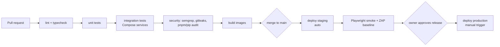

# SnapShare AI — Deployment

| Field | Value |
|---|---|
| Version | 0.1 (Draft, Batch 3) |
| Related | [INFRASTRUCTURE.md](INFRASTRUCTURE.md), [TESTING.md](TESTING.md) |

## 1. Artifacts

| Image | Source | Build targets |
|---|---|---|
| `snapshare/web` | `apps/web` | Static build served by nginx (or Cloudflare Pages, free, as an option) |
| `snapshare/api` | `apps/api` | Node 22 distroless |
| `snapshare/worker` | `apps/worker` | Node 22 + libvips + ffmpeg; entrypoints `relay \| media \| ai \| notify \| system` |
| `snapshare/ai-service` | `apps/ai-service` | `cpu` (python:3.12-slim + onnxruntime) and `cuda` (nvidia/cuda runtime + onnxruntime-gpu) |

- Images are tagged with `git sha` + semver on release and pushed to GHCR.
- Model weights are **not** baked into images. They are fetched at start from the private R2 `models/` prefix and verified by SHA-256.

## 2. Repository layout (Phase 1 will create)
```
infrastructure/
  docker/
    compose.yml              # base services
    compose.dev.yml          # local: hot reload, mailpit, minio, CPU AI
    compose.prod.yml         # prod overrides: resources, restart, logging
    compose.monitoring.yml   # prometheus, grafana, loki, tempo, glitchtip
    compose.gpu.yml          # ai-service cuda (GPU node)
  nginx/                     # site configs, security headers, rate-limit zones
  kubernetes/                # kept valid for S3; not used before then
  monitoring/                # dashboards, alert rules (as code)
  scripts/
    bootstrap-server.sh      # harden new VPS (ssh, ufw, fail2ban, docker, wireguard)
    deploy.sh                # pull images, migrate, rolling restart
    backup-mongo.sh / restore-mongo.sh
    fetch-models.sh
    gpu-node.sh              # start/stop on-demand GPU (provider API)
  models.lock                # model URLs + sha256 + license refs
```

## 3. Local development
```bash
cp .env.example .env              # never commit .env
pnpm install
docker compose -f infrastructure/docker/compose.yml -f infrastructure/docker/compose.dev.yml up -d
pnpm dev                          # web + api + workers with hot reload
# AI (optional): --profile ai starts ai-service (CPU) + qdrant
```
Services:
- mongo, as a single-node replica set because transactions need one
- redis
- qdrant
- MinIO, which stands in for R2
- Mailpit, which catches emails
- ai-service (CPU)

Seed scripts create plans, system roles, a demo studio, and **clearly labeled demo data** for local use only (spec §19).

## 4. CI/CD pipeline (GitHub Actions)



- **Owner control:** production deploys are a **manual `workflow_dispatch`** with a GitHub Environment protection rule. Only the owner can approve.
- **Path filters:** jobs run only for the apps that changed, which saves CI minutes.
- **Caching:** pnpm store, Docker layers (GHA cache), pip/uv cache.

## 5. Production deploy (Compose stages S0–S2)
`deploy.sh <version>` runs on the server over SSH from Actions:
1. `docker compose pull` for the new tags.
2. **Migrations** (`migrate-mongo up`): additive only. Destructive steps need a separate, owner-approved release (expand → migrate → contract).
3. Rolling restart:
   - api: start the new container → health check `/ready` → switch the nginx upstream → stop the old one. This gives zero downtime with two api containers.
   - workers: graceful shutdown (BullMQ `worker.close()` finishes the current jobs, with a 60 s timeout).
   - ai-service: new container warms its models, `/ready` turns true, then the old one stops.
4. Smoke checks: `/health`, a login probe, and a signed media URL fetch.
5. Record the deploy in Grafana annotations.

**Rollback:** `deploy.sh <previous-version>`. Migrations are backward compatible, so the previous version runs against the new schema.

## 6. Configuration & secrets
- **Validation:** all configuration comes from env vars validated by Zod (`packages/config`). A service refuses to start on invalid config.
- **Secrets:**
  - Stored in `infrastructure/secrets/prod.enc.yaml`, encrypted with **SOPS + age** (free).
  - Decrypted on the server at deploy time into a tmpfs-mounted env file.
  - Only the owner and the deploy key hold the age keys.
- **Rotation:** JWT signing keys use `kid` headers and overlap during rotation. R2 tokens rotate every 90 days. Payment webhook secrets rotate on staff changes.

## 7. GPU node lifecycle (ADR-016)
- `gpu-node.sh start` does the following:
  1. Creates or starts an instance from a saved image with Docker + the NVIDIA toolkit.
  2. Joins the WireGuard mesh.
  3. Runs `compose.gpu.yml`.
  4. Registers with the orchestrator as an extra ai-service upstream.
- `gpu-node.sh stop` drains the node (the orchestrator stops sending work, in-flight batches finish), then stops it. The instance is **destroyed, not just stopped**, if the provider bills stopped GPUs.
- These are triggered automatically by system-worker rules (AI_ARCHITECTURE §6.3), and manually from the admin console AD-31.

## 8. Kubernetes readiness (S3)
Requirements that apply from Phase 1:
- Health endpoints (`/health`, `/ready`) on every service.
- Graceful SIGTERM handling.
- No local disk state.
- Logs go to stdout.
- Config comes from env only.

Manifests (Deployments, HPA on CPU and on queue-depth via KEDA, PodDisruptionBudgets, NetworkPolicies) are linted in CI with `kubeconform` but not deployed until S3.

## 9. Release checklist (per phase)
- [ ] Owner approved the phase deliverables.
- [ ] CI green, including isolation and security jobs.
- [ ] Migrations reviewed (additive).
- [ ] Staging smoke + e2e passed.
- [ ] Docs updated (API_SPEC/OpenAPI, CHANGELOG-SPEC).
- [ ] Backup taken just before the production deploy.
- [ ] Owner triggered the production deploy.
