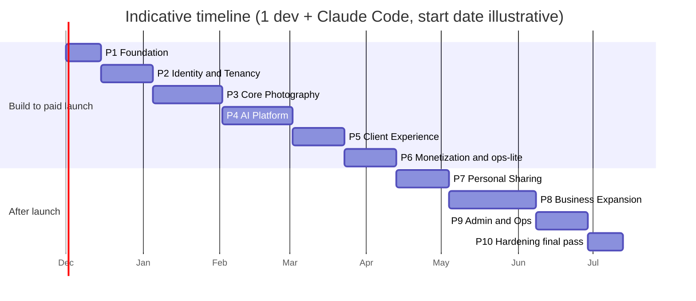
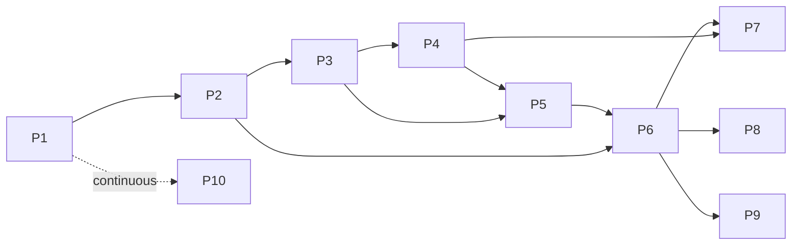

# SnapShare AI — Implementation Plan (Phases 1–10)

| Field | Value |
|---|---|
| Version | 0.1 (Draft, Batch 4) |
| Rules | Owner-gated (README). Each phase starts with a short **phase plan** for approval and ends with a **gate review**: demo + test evidence (TESTING §6) + docs updated |
| Definition of Done | MASTER_SPEC §20 + SECURITY §4 checklist |

## 0. Strategy: launch early, spend little

- **Paid launch after Phase 6.** Phases 1–6 give a sellable product: a photographer uploads, guests find their photos, clients proof, and the photographer pays. Revenue starts there.
- **Phases 7–9 are then paid for by revenue.** A minimal "ops-lite" admin is pulled forward into Phase 6, so we can support customers at launch without building the full admin console (Phase 9) first.
- **Build only what the current phase needs.** No speculative features (ADR-015).
- **Phase 4 includes a model-quality checkpoint.** If the free model (YuNet + SFace) isn't accurate enough, the owner decides on a commercial licence before Phase 5.

**Effort estimates** assume **1 full-stack developer + Claude Code**, part-time owner review, and are rough (±30%). They exist so the owner can plan, not as commitments.

**Total to paid launch ≈ 19 weeks; to the full spec ≈ 32 weeks.** Private beta with 5–10 friendly photographers starts at the end of Phase 5 (≈ week 16), with free accounts.

---

## Phase 1 — Foundation (≈ 2 weeks)
**Goal:** a working skeleton anyone can run with one command.

| Milestone | Deliverables | Acceptance criteria |
|---|---|---|
| 1.1 Monorepo | pnpm + Turborepo; `apps/{web,api,worker,ai-service}`, `packages/{ui,types,config,validators}`; TS strict; ESLint + boundaries; Prettier; project-level `CLAUDE.md`/`AGENTS.md` overriding the InsForge default (ADR-002) | `pnpm build`, `pnpm lint` and `pnpm typecheck` pass on a clean clone |
| 1.2 Local infra | `compose.yml` + `compose.dev.yml`: mongo (single-node RS), redis, qdrant, minio, mailpit; `.env.example`; `packages/config` Zod env validation | `docker compose up` → all healthy; a service refuses to start with invalid env |
| 1.3 API skeleton | Express 5 app, `kernel/` (errors RFC 9457, request ID, pino, OTel, health/ready, rate-limit, Zod middleware, route registry), OpenAPI generation from Zod, Socket.IO with Redis adapter | `/health` and `/ready` OK; `/docs` serves the generated OpenAPI; unknown route → problem+json |
| 1.4 Worker skeleton | BullMQ queue registry (`packages/config/queues.ts`), outbox model + relay, DLQ handling, graceful shutdown | Integration test: outbox write → job runs exactly once; failing job → DLQ |
| 1.5 Web skeleton | Vite + React + TS + Tailwind + shadcn/ui; router with the 4 app shells (public, studio, personal, admin); TanStack Query client; design tokens; EmptyState/ErrorState/Skeleton components | Lighthouse ≥ 90 on the empty landing page; shells render |
| 1.6 AI skeleton | FastAPI app, provider interfaces, CPU Docker image, `/health` `/ready` `/metrics`, service-token auth | Container builds; readiness gate works |
| 1.7 CI | GitHub Actions: lint, typecheck, unit, integration (Compose), Semgrep, gitleaks, audits, image builds (path-filtered) | Green pipeline on the first PR; run time < 15 min |

**Cost added:** ₹0. Everything runs locally and in free CI.

## Phase 2 — Identity & Tenancy (≈ 3 weeks)
| Milestone | Deliverables | Acceptance |
|---|---|---|
| 2.1 Auth | Signup, email verify, login, logout, refresh rotation, forgot/reset, sessions list/revoke, Google OAuth, CSRF, lockout, Turnstile | TESTING §3 auth suite green; AUTH-01…06 screens with all states |
| 2.2 Studios & membership | Create studio, workspace switcher, invitations, roles seeded, permission engine, `ScopedRepository` | ONB-01/02, ST-02, ST-40, GL-01…03 |
| 2.3 Isolation framework | Route registry metadata + generated isolation tests (TESTING §4) | CI fails on a route without metadata; all routes covered |
| 2.4 Audit | `audit.record` + ST-41 studio activity | Sensitive actions appear; the collection is append-only for the app role |
| 2.5 Legal pages | Terms, Privacy, Biometric notice v1 (drafts, ⚖️ review before launch) | PUB-03 |

**Cost added:** an email provider on its free tier (₹0).

## Phase 3 — Core Photography (≈ 4 weeks)
| Milestone | Deliverables | Acceptance |
|---|---|---|
| 3.1 Events & albums | CRUD, archive, reorder; ST-10/11/14 | Entitlement hooks stubbed to the "default plan" config (no hardcoded limits) |
| 3.2 Upload engine | Upload sessions, multipart presign, resume, cancel, duplicate detection, folder upload, Web Worker hashing, global upload tray | 5,000-file upload survives a browser refresh; k6 upload scenario meets target |
| 3.3 Media pipeline | MIME sniffing, EXIF, GPS strip, Sharp variants (right-sized), pHash, watermark presets, failed tab + retry | Original hash unchanged; bomb and spoof tests pass |
| 3.4 Delivery | Media gateway (Cloudflare Worker + B2), HMAC tokens, presigned original downloads through the gateway | Private objects are inaccessible without a token; CDN hit ratio measured |
| 3.5 Gallery (public, basic) | Share link (no PIN yet), PUB-10/12/12a masonry and grid, infinite scroll, lazy loading, viewer | LCP < 2.5 s on throttled 4G for a 5k-photo gallery |
| 3.6 Realtime progress | Socket.IO upload and processing events | Event detail grid fills in live |

**Cost added:** first real storage use on B2 (a few hundred ₹) and the Cloudflare Worker free tier.
**Video (3b)** is deferred until after launch unless the owner pulls it forward (ARCHITECTURAL_GAPS G7).

## Phase 4 — AI Platform (≈ 4 weeks)
| Milestone | Deliverables | Acceptance |
|---|---|---|
| 4.1 Providers & registry | YuNet + SFace ONNX providers, golden tests, `aiModelVersions` with licence gate, dynamic batcher, warmup | Activation blocked when `commercialUse ≠ true` |
| 4.2 Indexing | ai-orchestrator, `/v1/faces/index`, Qdrant collection + payload indexes, `faceDetections`, tenant-fair queueing | CPU throughput benchmark recorded (validates INFRASTRUCTURE §4.2) |
| 4.3 Consent & guest identity | Consent texts EN/HI, `consents`, guest email OTP, PUB-13/14 | Searching without consent → 403 |
| 4.4 Selfie match | Selfie upload, `/v1/faces/match`, confidence bands, "Not me", PUB-15/16, ME-40 revoke + verified deletion | AI privacy suite green; p95 < 30 s end to end |
| 4.5 Retention & deletion | Expiry sweepers, `ai.face.delete`, bystander removal request form | Qdrant count = 0 after revoke / event delete |
| 4.6 **Quality checkpoint** 🔶 | Evaluation harness on a consented test set; report TAR@FAR, recall@K, not-me rate | **Owner gate:** accept the free model, or approve a commercial licence purchase |
| 4.7 GPU on demand | `gpu-node.sh`, autoscale rule, monthly GPU-hour budget | Dry run on a rented GPU for < 1 hour (≈ ₹50) |

## Phase 5 — Client Experience (≈ 3 weeks)
Includes: PIN/OTP gates, share-link permissions and expiry, QR generation (PNG/SVG/poster PDF with the bystander notice), guest list and invitations, favorites, comments, proofing sets (PUB-20/21, ST-20/21) with exports, zip downloads (async), notifications center, basic analytics (ST-19).

**Acceptance:**
- Gallery/sharing and proofing suites green.
- Concurrent proofing test.
- **Private beta starts** with free accounts for 5–10 photographers.

## Phase 6 — Monetization + ops-lite (≈ 3 weeks) → 🚀 paid launch
| Milestone | Deliverables |
|---|---|
| 6.1 Plans & entitlements | Versioned `plans`, resolver + Redis cache, `PlanGate` UI, usage meters, Redis counters + nightly reconciliation |
| 6.2 Razorpay | Subscriptions, Checkout (UPI/cards), webhooks (verified, idempotent), upgrade/downgrade/cancel, grace → read-only, GST invoices (PDF) |
| 6.3 Stripe adapter | Same interface; enabled by flag (global customers later) |
| 6.4 Billing UI | ST-70, ME-42, PUB-02 pricing from the API, ONB-03 trial |
| 6.5 Ops-lite admin | AD-00 MFA login, AD-10/11 search + suspend, AD-14 plan editor, AD-30 queue/DLQ retry, AD-40 audit search. Everything else is read through Grafana |
| 6.6 Launch readiness | ⚖️ legal pages reviewed, backups + restore drill, monitoring alerts live, free security self-assessment (ADR-020), production on S0/S1 |

**Acceptance:** billing suite green, including signature-failure and duplicate-webhook tests. Real ₹1 test transactions are made in Razorpay test mode, then one live transaction is made and refunded.

## Phase 7 — Personal Sharing (≈ 3 weeks)
Includes: personal albums, groups, invites, mobile-first upload, "My Event Photos", personal enrollment + "Photos of me", favorites, storage management, data export, account deletion with grace period, Personal Pro plan, PWA install.

Semantic search is **optional**. It needs a commercially licensed CLIP-family model (G9) and is only built if it fits the CPU budget.

## Phase 8 — Business Expansion (≈ 5 weeks)
Includes: CRM (clients, leads, bookings, client invoices with GST), portfolio builder + public portfolio, custom domains (Caddy on-demand TLS, free), gallery themes, white-label, digital album builder.

**Priority order is set by customer demand at the time.** The owner can drop or reorder items.

## Phase 9 — Admin & Ops (≈ 3 weeks)
Includes: full super-admin consoles (dashboard, revenue analytics, storage monitoring, AI/GPU console with model activate/rollback, moderation queue, feature flags UI, health), impersonation with audit, refunds, and overrides.

## Phase 10 — Production Hardening (continuous + 2-week final pass)
Includes: full k6 load suite, performance tuning, DR drill (restore Mongo + re-index Qdrant from photos), ZAP full scan + ASVS self-assessment re-run, documentation, runbooks, the paid pentest once its trigger is met (ADR-020), and the move to S2 topology when growth requires it.

---

## Cross-phase dependencies

## Owner checkpoints (summary)

| When | Owner decides |
|---|---|
| Start of each phase | Approve the phase plan |
| End of each phase | Approve the gate (demo + tests + docs) → commit/tag |
| Phase 4.6 | Free face model good enough, or buy a licence? |
| Before Phase 6 launch | Final prices, legal review spend, launch go/no-go |
| Every new recurring cost > ₹2,000/month | Approve or reject (ADR-015) |
| Stage moves (S0 → S1 → S2) | Approve the infrastructure upgrade |
