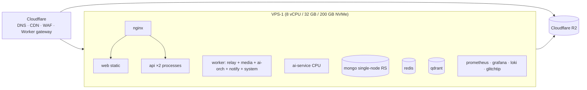
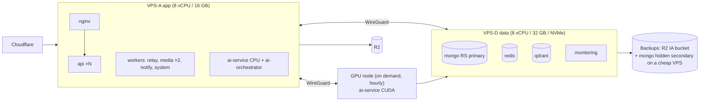

# SnapShare AI — Infrastructure Plan (Cost-First)

| Field | Value |
|---|---|
| Version | 0.1 (Draft, Batch 3) |
| Principle | ADR-015 **cost-first**: smallest footprint that meets the current stage; scale by adding boxes, not by re-architecting |
| Related | [DEPLOYMENT.md](DEPLOYMENT.md), [ARCHITECTURE.md](ARCHITECTURE.md) §8–9, [AI_ARCHITECTURE.md](AI_ARCHITECTURE.md) §6 |

> 💰 **Prices are indicative** (late-2026 list prices converted at about ₹85/USD, rounded). They must be re-checked before purchase. Any new recurring cost above ₹2,000/month needs owner approval (ADR-015).

---

## 1. Growth stages

| Stage | Trigger | Shape | Est. monthly cost |
|---|---|---|---|
| **S0 — Dev / private beta** | Now → first ~30 studios | **1 Hetzner server** runs everything in Docker Compose | **₹3k–6k** |
| **S1 — Launch** | ~30 → 300 paying studios | **2 Hetzner servers** (app + data), CPU AI worker, GPU on demand | **₹8k–15k** + storage |
| **S2 — Growth** | 300 → 2,000 studios, or 99.9% SLA needed | 4–6 servers: app ×2 behind LB, Mongo 3-node replica set, dedicated workers, Qdrant node | **₹25k–50k** + storage + GPU hours |

> **Owner decision (2026-11-17):** cheaper hosting outside India is accepted (ADR-018). Quality stays the same: the same software and capacity, just a cheaper provider. Images reach Indian users from Cloudflare's India edge cache, so photo loading speed is unaffected. API calls gain about 120–150 ms of latency, which users barely notice.
| **S3 — Scale** | 2,000 → 10,000+ studios | Kubernetes (k3s on VPS or managed), autoscaled pools, Qdrant cluster, Mongo sharding readiness | Driven by usage; covered by revenue |

**Storage and GPU are usage-driven and scale with paying customers.** The plans (PRD §6) must price them in. Batch 4's risk register checks the margins.

## 2. Vendor choices (cheapest viable)

| Need | Choice | Why | Cost note |
|---|---|---|---|
| Compute (CPU) | **Hetzner** (ADR-018). S0/S1: a **dedicated AX-line server** (e.g. 8-core Ryzen, 64 GB RAM, 2× NVMe RAID-1) gives the best price/performance. Cloud CPX/CCX instances when hourly flexibility is needed. Use the Singapore location if available for lower latency, otherwise Germany/Finland | Roughly 3–5× cheaper than India-region clouds for the same CPU and RAM | Dedicated 8c/64 GB ≈ ₹4k–5k/mo; cloud 8 vCPU/16 GB ≈ ₹2.5k–3.5k/mo |
| GPU (on demand) | Hourly GPU marketplace with a start/stop API (**RunPod / Vast.ai** cheapest; E2E Networks as the India fallback) | Scale-to-zero (ADR-016); only pay for minutes used | RTX 4090/A4000/L4-class ≈ ₹25–60/hour; **₹0 when idle** |
| Object storage | **Backblaze B2 behind Cloudflare** (ADR-019). R2 is the fallback | B2 storage is ~60% cheaper than R2. Downloads from B2 through Cloudflare are **free** (Bandwidth Alliance), so we still pay zero egress. S3-compatible, so we can switch any time | ≈ ₹0.5/GB-month (~$6/TB); first 10 GB free |
| CDN + DNS + WAF + DDoS | **Cloudflare Free** → Pro (~₹1.7k/mo) only if needed | Free unmetered CDN and DDoS; Workers free tier: 100k requests/day | ₹0 at S0–S1 |
| Media gateway | Cloudflare Worker (ADR-006) | Free tier, then about $5/mo for 10M requests | ₹0 → ₹425 |
| MongoDB | **Self-hosted** Community 7 in Docker (S0–S1) → 3-node replica set (S2) | MongoDB Atlas costs several times more at our sizes | Included in VPS |
| Redis | Self-hosted Redis 7 (or Valkey) | — | Included |
| Qdrant | Self-hosted OSS, int8 quantization + on-disk vectors | Qdrant Cloud is unnecessary at S0–S2 | Included |
| Email | **Amazon SES** (≈ $0.10 per 1,000) or Brevo/Resend free tier at S0 | Cheapest transactional email | < ₹500/mo for a long time |
| OTP | **Email OTP by default** (≈ free); SMS via an Indian DLT-registered provider (e.g. MSG91) only where studios enable it | SMS ≈ ₹0.15–0.25 per message + DLT registration | Budget cap + kill switch |
| Monitoring | Self-hosted Prometheus + Grafana + Loki + Tempo; **GlitchTip** for errors (ADR-017) | Free | Uses about 1–2 GB RAM on the ops host |
| CI/CD | GitHub Actions (free minutes for private repos) + GHCR | — | ₹0 within free quota |
| Backups | R2 bucket (separate, Infrequent Access) | — | A few hundred ₹ |
| VPN for admin | WireGuard | Free | ₹0 |
| TLS | Cloudflare origin certificates + Let's Encrypt (custom domains, Phase 8) | Free | ₹0 |

**Deliberately avoided at S0–S2:** managed Kubernetes, MongoDB Atlas, Qdrant Cloud, Datadog/New Relic, always-on GPU instances, AWS S3 for media delivery (egress costs).

## 3. Topology by stage

### S0 — single box

### S1 — app/data split + on-demand GPU

### S2 — high availability
- **App tier:** 2+ app VPS behind Cloudflare Load Balancing (≈ $5/mo) or a provider load balancer.
- **MongoDB:** 3-node replica set (primary, secondary, plus a cheaper secondary or arbiter).
- **Redis:** Sentinel, with 3 Redis processes co-located.
- **Qdrant:** a dedicated node with 2× RAM headroom for the vectors in use.
- **Workers:** a separate media-worker VPS pool; CPU AI workers scale by adding VPS.

### S3 — Kubernetes
Manifests live in `infrastructure/kubernetes/` from Phase 1 (spec §15). They are kept valid, but **not used until S3**. Compose stays the source of truth until then. Use k3s on VPS to avoid control-plane fees, or managed Kubernetes if the ops cost justifies it.

## 4. Capacity & cost model

### 4.1 Storage per event (the dominant variable cost)
| Item | Per photo | 5,000-photo wedding |
|---|---|---|
| Original JPEG (Lightroom export) | ~8–15 MB (avg 10) | ~50 GB |
| Variants (thumb 30 KB + preview 200 KB + web 500 KB + wm_preview 200 KB, see lever 2) | ~0.93 MB | ~4.7 GB |
| **Total** | ~10.9 MB | **~55 GB** |
| B2 monthly (ADR-019) | | **≈ ₹29/month per wedding** (R2 would be ≈ ₹75) |

**Cost levers** (Batch 4 asks the owner to approve these):
1. **Cheaper provider:** B2 instead of R2 (ADR-019) cuts storage cost by about 60%, with the same quality and durability.
2. **Right-sized variants (no visible quality loss, all spec §8 variants kept):**
   - thumb: 400 px WebP, ~30 KB
   - preview: 1200 px WebP, ~200 KB (grid and mobile lightbox)
   - web: 2048 px WebP at q≈82, ~500 KB (full screen and "web size" download)
   - wm_preview: 1200 px, ~200 KB

   That is ≈ 0.93 MB per photo instead of 1.6 MB, about **40% less variant storage**. "Full quality" download always serves the untouched original.
3. **Plan quotas:** pricing per GB must cover the storage cost plus a margin. Batch 4's RISK_REGISTER checks every plan at **full** quota use.
4. **Original retention option:** studios choose "keep originals for N months, then web-quality only". This is opt-in, because spec §8 says originals are never overwritten silently.

### 4.2 Compute
| Workload | S0/S1 sizing | Notes |
|---|---|---|
| api | 1–2 vCPU, 1 GB per process | Stateless; mostly I/O |
| media-worker | 2 vCPU + 2 GB per concurrent job | Sharp is CPU-bound: about 0.3–0.8 s per photo for all variants |
| ai-service CPU | 4–8 vCPU | AI_ARCHITECTURE §6.2: ~25k–60k photos/hour with YuNet + SFace (to benchmark) |
| MongoDB | RAM ≥ working set (indexes + hot docs) | S1: 8–16 GB is plenty |
| Qdrant | 128-d SFace + int8: ~150 bytes per vector including overhead; **10M faces ≈ 1.5–3 GB RAM** | Retention keeps it bounded (AI_ARCHITECTURE §9) |

**Example: S1 at 200 studios** (each ~4 events/month × 3k photos = 2.4M photos/month)
- Media processing: 2.4M × 0.5 s ≈ 333 CPU-hours/month → **one 8-vCPU worker is enough** with plenty of headroom.
- AI indexing: 2.4M photos ÷ ~30k/hour ≈ 80 hours/month on one 8-vCPU box → **CPU is enough**. GPU is used only for peak bursts.
- New storage: 2.4M × ~10.9 MB (right-sized variants) ≈ **26 TB/month** → ≈ ₹13k/month added each month on B2 (≈ ₹34k on R2). This is cumulative until retention or archival kicks in, but always capped by plan quotas. **This is where pricing and quotas matter most.**

## 5. Data protection & DR

| Item | S0 | S1 | S2+ |
|---|---|---|---|
| MongoDB | Nightly `mongodump` → encrypted → R2 (30 daily, 12 monthly) | + hidden secondary on a cheap VPS (near-real-time copy) + hourly oplog archive | Replica set + PITR from oplog (RPO ≤ 15 min) |
| Redis | AOF every second; only queues matter, and these are rebuildable from the outbox | Same | Sentinel |
| Qdrant | Weekly snapshot → encrypted → R2. **Vectors are re-derivable** from photos by re-indexing, so the backup is a convenience, not the source of truth | Daily snapshot | Replication factor 2 |
| Object storage | R2 durability; **versioning is off**. Originals are protected by an immutable key policy plus a bucket token that the API can't delete with; deletion happens only through the cascade job's dedicated token | Same | Optional second-bucket replication for originals of paying Enterprise tenants only (cost) |
| Restore drill | Monthly scripted restore into a scratch VPS (Phase 10 gate) | | |
| RTO target | 8 h (S0), 4 h (S1+) | | |

## 6. Observability footprint (ADR-017)
- **Prometheus:** scrapes api, workers, ai-service, node-exporter, mongodb-exporter, redis-exporter, Qdrant `/metrics`, and the BullMQ exporter. Data kept 15 days.
- **Grafana dashboards** (as code in `infrastructure/monitoring/`):
  - API RED: rate, errors, duration
  - queues: depth, lag, DLQ
  - media throughput
  - AI: inference latency, lag, not-me rate, GPU hours vs budget
  - data stores
  - storage growth
  - business: signups, MRR (from Mongo through a small exporter)
- **Logs:** Loki keeps 7 days on S0/S1.
- **Traces:** Tempo with 5% sampling, kept 7 days.
- **Alerts:** Alertmanager → Telegram bot and email (free).

**Key alerts:**
- API 5xx > 2% for 5 min
- p95 > 1 s
- queue lag > SLA
- any DLQ message on `face.delete`, `deletion.cascade` or `billing.webhook`
- disk > 80%
- Mongo replication lag
- certificate expiry
- GPU budget at 80%
- daily SMS spend cap reached

## 7. Environments

| Env | Where | Cost |
|---|---|---|
| local | Developer machine, Docker Compose (CPU AI) | ₹0 |
| ci | GitHub Actions runners | ₹0 (free quota) |
| staging | **Shares the S0 box** using a separate Compose project, databases and R2 bucket prefix. Moves to its own small VPS at S1 if needed | ₹0 → ~₹1.5k |
| production | As per stage | §1 |
