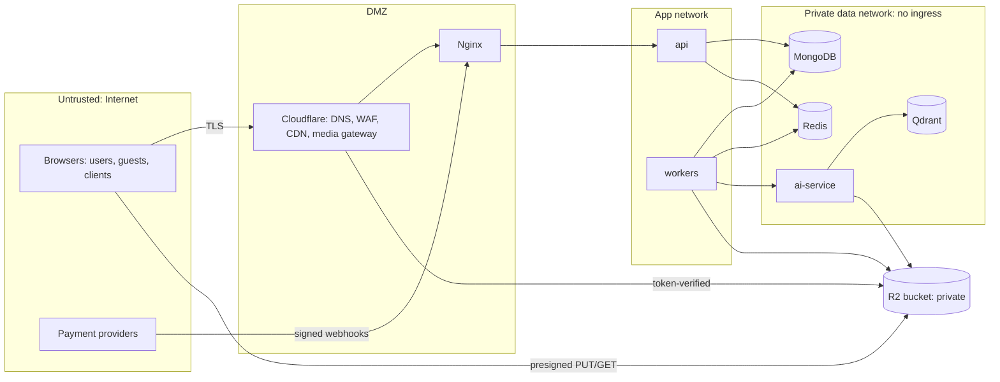

# SnapShare AI — Security, Threat Model & Privacy Compliance

| Field | Value |
|---|---|
| Version | 0.1 (Draft, Batch 3) |
| Target | OWASP ASVS 4.0 Level 2 · DPDP Act 2023 (India) · readiness for GDPR/BIPA later |
| Related | [ARCHITECTURE.md](ARCHITECTURE.md), [AI_ARCHITECTURE.md](AI_ARCHITECTURE.md) §9, [API_SPEC.md](API_SPEC.md) §1 |

> This document is an engineering threat model, not legal advice. Items marked ⚖️ need review by a qualified Indian privacy lawyer before launch.

---

## 1. Assets (by sensitivity)

| Tier | Asset | Why it matters |
|---|---|---|
| **S0** | Face embeddings, selfies, consent records | Biometric data: highest legal and reputational risk |
| **S1** | Original photos and videos (private events, weddings, children), GPS EXIF | Personal and intimate content; contracts with clients |
| **S1** | Credentials: password hashes, sessions, refresh tokens, OAuth links, TOTP secrets | Account takeover |
| **S1** | Secrets: storage keys, JWT signing keys, payment keys, service tokens | Platform compromise |
| **S2** | PII: emails, phones, names, GSTIN, addresses, guest identities | Privacy, spam, DPDP |
| **S2** | Billing state, invoices | Fraud, revenue loss |
| **S3** | Business data: events metadata, CRM, analytics | Confidentiality between studios |

## 2. Trust boundaries

**Boundary rules:**
- Only Cloudflare → Nginx ports 80 and 443 are open. The origin firewall allows **only Cloudflare IP ranges**.
- MongoDB, Redis, Qdrant and ai-service bind to private interfaces or a WireGuard mesh. They have no public IPs, and each requires authentication even on the private network.
- Admin tools (Grafana, queue dashboard, Mongo) are reachable only over WireGuard VPN. This is free, and there is no public admin surface.

## 3. STRIDE threat model

### 3.1 Identity & sessions
| Threat | STRIDE | Mitigation |
|---|---|---|
| Credential stuffing / brute force | S | Rate limits (API_SPEC §1.6); progressive lockout; Cloudflare Turnstile (free) after failures; breached-password check (k-anonymity HIBP range API, free) at signup and reset |
| Session theft through XSS | S/I | HttpOnly cookies; strict CSP (`default-src 'self'`; no inline scripts; nonce for any needed exception); React escaping; DOMPurify for the little user HTML we accept (comments are plain text) |
| CSRF | T | SameSite=Lax + double-submit token + Origin check on state-changing requests |
| Refresh-token replay | S | Rotation + family reuse detection → revoke the family and the session; notify the user |
| Account enumeration | I | Uniform responses and timing on signup, login and forgot-password |
| Password storage | I | argon2id (m=64 MB, t=3, p=1), with parameters stored in the hash for upgrades |
| OAuth login CSRF / code interception | S | State + PKCE + nonce; exact redirect URI allowlist |
| Admin takeover | E | Mandatory TOTP for platform roles; admin access through VPN; admin sessions expire after 12 h; impersonation is time-boxed, audited and can't take billing actions |
| OTP abuse / SMS pumping (cost attack) | D/$ | Per-phone, per-IP and per-gallery limits; Turnstile; **email OTP as the default** (near-free) with SMS only where the studio enables it; daily SMS budget kill switch |

### 3.2 Multi-tenancy & authorization (highest priority)
| Threat | STRIDE | Mitigation |
|---|---|---|
| IDOR (guessing another tenant's IDs) | I/E | Scope resolved server-side; `ScopedRepository` injects the scope filter; lint rule bans raw model queries; **404 on cross-scope access**; automated isolation test suite on every route (TESTING §4) |
| Frontend-supplied tenantId trusted | E | `studioId` in the path is only a selector, always validated against memberships (ARCHITECTURE §5.2) |
| Privilege escalation inside a studio | E | Permission checks per action; can't grant a role higher than your own; the last owner is protected; role changes audited |
| Removed member keeps access | E | Membership removal clears the per-user membership cache in Redis immediately; access tokens live ≤ 10 min, and the membership check runs on every request |
| Gallery token reused for another event | E | Gallery JWT claims bind `shareLinkId` + `eventId`; every public query filters by them |
| Share-code guessing | I | ≥ 10-character base62 codes (~59 bits) + rate limiting + optional PIN/OTP; codes are never sequential |
| Socket.IO room snooping | I | Server authorizes room joins; room names are never trusted |
| Cross-tenant vector search | I | AI_ARCHITECTURE §9: signed scope + mandatory filter + test |

### 3.3 Uploads & media
| Threat | STRIDE | Mitigation |
|---|---|---|
| Malicious files (polyglots, image-parser exploits, decompression bombs) | T/E | Magic-byte MIME check; Sharp/libvips with `limitInputPixels` (e.g. 200 MP); media worker runs in a non-root, read-only container with no network except storage and DB; FFmpeg with a protocol whitelist (`file` only), timeout and memory cap |
| Presigned URL abuse (uploading huge or unlimited data) | D/$ | Presigned for an exact key, Content-Length range, 15-min expiry; quota reserved at session creation and reconciled on completion; orphan sweeper |
| Hotlinking or leaking private photos | I | Private bucket; HMAC delivery tokens with expiry; token bound to a gallery key prefix; originals only through download authorization |
| EXIF GPS leak (home addresses) | I | GPS stripped from all derivatives by default; originals downloadable only when the photographer allows it |
| Watermark bypass | I | Watermark baked into the `wm_preview` derivative (not a CSS overlay); clean variants are never served when the gallery requires a watermark |
| Storage key compromise | All | Separate R2 tokens per service with least privilege (api: presign only; media-worker: read original / write variants; ai-service: read previews, write/delete `tmp/selfies`); rotated every 90 days |
| Illegal content (CSAM, etc.) | Legal | Abuse reporting + moderation queue; studio and account suspension; legal takedown process. ⚖️ Evaluate PhotoDNA-style hash matching. Many such services are free for qualifying platforms, but integration may involve sending hashes externally, which needs a review against the "no external AI" rule. Hashes aren't inference, so this is likely acceptable |

### 3.4 Payments
| Threat | Mitigation |
|---|---|
| Forged webhooks | Signature verified on the raw body; `webhookEvents` idempotency store; plan never granted from the client callback |
| Replay | Event ID uniqueness + timestamp tolerance (Stripe) |
| Price tampering | Server picks the price from `plans`; the client sends only `planKey` + `interval` |
| Card data | Never touches our servers (Razorpay Checkout / Stripe Checkout) → PCI scope SAQ-A |

### 3.5 Infrastructure & supply chain
| Threat | Mitigation |
|---|---|
| Vulnerable dependencies | Dependabot/Renovate; `pnpm audit` and `pip-audit` in CI; lockfiles; minimal base images (distroless or alpine for Node, slim for Python) |
| Leaked secrets | `.env` git-ignored; `gitleaks` in CI and pre-commit; secrets injected at deploy time from an encrypted file (SOPS + age, free) |
| Container escape / lateral movement | Non-root users; read-only root filesystem; no `privileged` containers; separate Docker networks per tier |
| Server compromise | SSH keys only, no root login, fail2ban, unattended security upgrades, CrowdSec (free) |
| Model supply chain (tampered weights) | Weights pinned by SHA-256 in `models.lock` and in the registry; verified on load |
| Backup theft | Backups encrypted (age) before upload; separate R2 bucket with a write-only token from the servers |
| Logging PII | pino redaction paths; no request bodies logged on auth or consent routes; IPs hashed |

### 3.6 Availability / DoS
| Threat | Mitigation |
|---|---|
| L3/L4/L7 floods | Cloudflare (free plan includes unmetered DDoS protection) |
| Expensive endpoints (zip export, face search, presign) | Per-user and per-gallery quotas; jobs are async and queued; queue depth limits per tenant (ADR-005) |
| Gallery stampede (5k guests at once) | Images served from the CDN cache; gallery metadata cached in Redis for 30 s; cursor pagination |

## 4. Security controls checklist (Definition of Done additions)
Every module's Definition of Done (spec §20) also requires:
- [ ] Zod validation on all inputs (body, params, query), with unknown keys stripped.
- [ ] A permission check plus scope enforcement, with isolation tests added.
- [ ] Rate-limit class assigned.
- [ ] Audit events for sensitive actions.
- [ ] No secrets, PII or embeddings in logs.
- [ ] Error responses checked for information leakage.
- [ ] Deletion path implemented (what happens to this data when its account, studio or event is deleted).

## 5. HTTP security headers (Nginx + API)
- `Strict-Transport-Security: max-age=63072000; includeSubDomains; preload`
- `Content-Security-Policy`: `default-src 'self'; img-src 'self' https://media.snapshare.in data: blob:; connect-src 'self' https://api.snapshare.in wss://api.snapshare.in https://*.r2.cloudflarestorage.com https://api.razorpay.com; script-src 'self' https://checkout.razorpay.com https://js.stripe.com https://challenges.cloudflare.com; frame-src https://api.razorpay.com https://js.stripe.com https://challenges.cloudflare.com; frame-ancestors 'none'; object-src 'none'; base-uri 'self'`
- `X-Content-Type-Options: nosniff` · `Referrer-Policy: strict-origin-when-cross-origin` · `Permissions-Policy: camera=(self), geolocation=(), microphone=()` (camera for selfies)
- CORS: allowlist of our own origins plus verified custom domains; `credentials: true`; never `*`.

## 6. Audit logging
- **Events:**
  - auth: login, failed login, password change, MFA, session revoke
  - membership and role changes
  - share-link creation and revocation
  - download of originals
  - consent grant and revoke
  - face search
  - biometric deletion
  - plan change
  - refunds
  - admin actions: impersonation, suspension, override, model activation, flag changes
  - data export
  - account deletion
- **Storage and access:**
  - Append-only: the application DB role can insert into `auditLogs` but not update or delete.
  - Exported weekly to cold storage (R2 Infrequent Access).
  - Visible to studio owners for their own scope; admins see everything.

## 7. Incident response (lightweight)
1. **Detect** through alerts (Grafana → Telegram or email, both free) and reports.
2. **Triage:** a severity matrix with S0 data exposure = Sev1.
3. **Contain:** revoke keys or sessions, disable a share link, suspend an account. Each has a runbook.
4. **Notify.** ⚖️ The DPDP Act requires notifying the **Data Protection Board and affected users** of personal data breaches; timelines are set by the DPDP Rules. CERT-In's 2022 directions require reporting certain cyber incidents **within 6 hours**. Phase 10 adds runbook templates.
5. **Post-mortem** within 5 days, recorded in `docs/incidents/`.

## 8. Privacy compliance — DPDP Act 2023 (India first)

| DPDP concept | How SnapShare maps | Design response |
|---|---|---|
| **Data Fiduciary / Data Processor** | For **studio event photos**, the studio is the Fiduciary (it decides to photograph and share) and SnapShare is the **Processor**. For **personal accounts and guest selfie search**, SnapShare is the **Fiduciary** for the guest's own selfie and consent | Studio Terms + **Data Processing Agreement** accepted when enabling AI on an event. Guest consent is captured directly by SnapShare |
| Notice (s.5) | Consent screen gives an itemized notice: data (selfie → face template), purpose (finding your photos in *this* event), retention, rights, grievance contact | Versioned notices in EN + HI (+ other Eighth Schedule languages later, ⚖️ check what's required) |
| Consent (s.6): free, specific, informed, unambiguous, withdrawable as easily as given | Separate checkbox, not bundled with T&C; one-tap revoke at ME-40 / gallery menu | `consents` collection; revoke SLA 24 h |
| Purpose limitation | Face templates are used **only** for matching within the consented scope. Never used for training, marketing or cross-event search | Enforced technically (signed scope filters) and contractually |
| Retention / erasure (s.8(7)) | Erase once the purpose is served | Retention table (DATABASE_SCHEMA §14; AI_ARCHITECTURE §9) + verified deletion |
| Children (s.9) | **Verifiable parental consent** required for under-18s; no tracking or behavioural monitoring of children | Self-declared minors are blocked from selfie search in v1. Guardian flow needs an owner decision + ⚖️ |
| Data principal rights | Access, correction, erasure, grievance, nominate | ME-40/ME-50 + a grievance officer contact; `/me/exports` gives access |
| Security safeguards (s.8(5)) | Reasonable safeguards | This document |
| Breach notification (s.8(6)) | Notify the Board + affected principals | §7 |
| Cross-border transfer (s.16) | Allowed except to countries the government restricts | **Owner decision (ADR-018): cheaper hosting outside India** (Hetzner EU/Singapore, Backblaze B2 EU region). The privacy policy discloses this. Data is encrypted in transit and at rest. ⚖️ Lawyer to confirm no sector-specific localization applies and to re-check whenever the government publishes its restricted-country list |
| Consent Managers | Optional ecosystem | Not in v1 |
| Bystanders in event photos | Biometric processing of people who did not consent | Mitigations: scoped indexing, matching only against a consenting searcher, venue notice on the QR poster, short retention, studio DPA, opt-out request form ("remove my face from this event") → deletes that person's face points (via a selfie-based removal request). ⚖️ **Key legal review item** |

**GDPR/BIPA readiness (later markets).** Biometric data is special-category data under GDPR Art. 9 and needs explicit consent. Illinois BIPA requires a written retention policy and written release, with private right of action, so it is high risk. Before entering those markets: run a DPIA, add region-pinned data stores, and consider disabling bystander indexing (enrollment-first matching only) per region with a feature flag.

## 9. Security testing plan (summary; details in TESTING.md)
- **Every PR:** SAST (Semgrep, free), dependency audit, gitleaks.
- **Per phase:** tenant-isolation suite; OWASP ZAP baseline scan against staging (free).
- **Before launch (Phase 10):** a **free structured self-assessment** against the OWASP ASVS L2 checklist, plus free tools (ZAP full scan, Nuclei, Semgrep, Trivy), plus the automated isolation suite. A paid external pentest (~₹1–3 lakh) is **deferred until revenue justifies it** (proposal: once MRR passes ₹2 lakh or the first Enterprise customer asks for one). Owner decision (2026-11-17): save money now (ADR-020).
