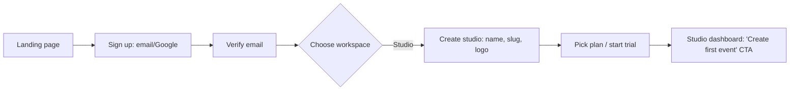
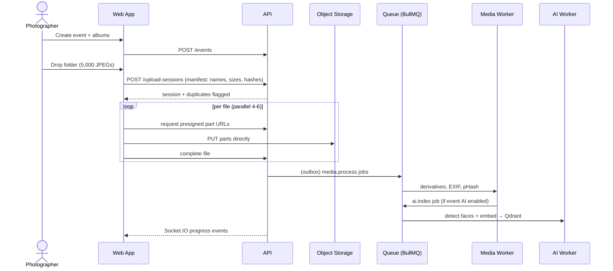
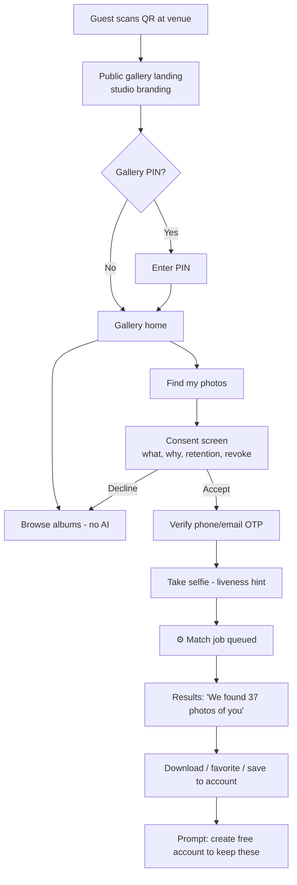
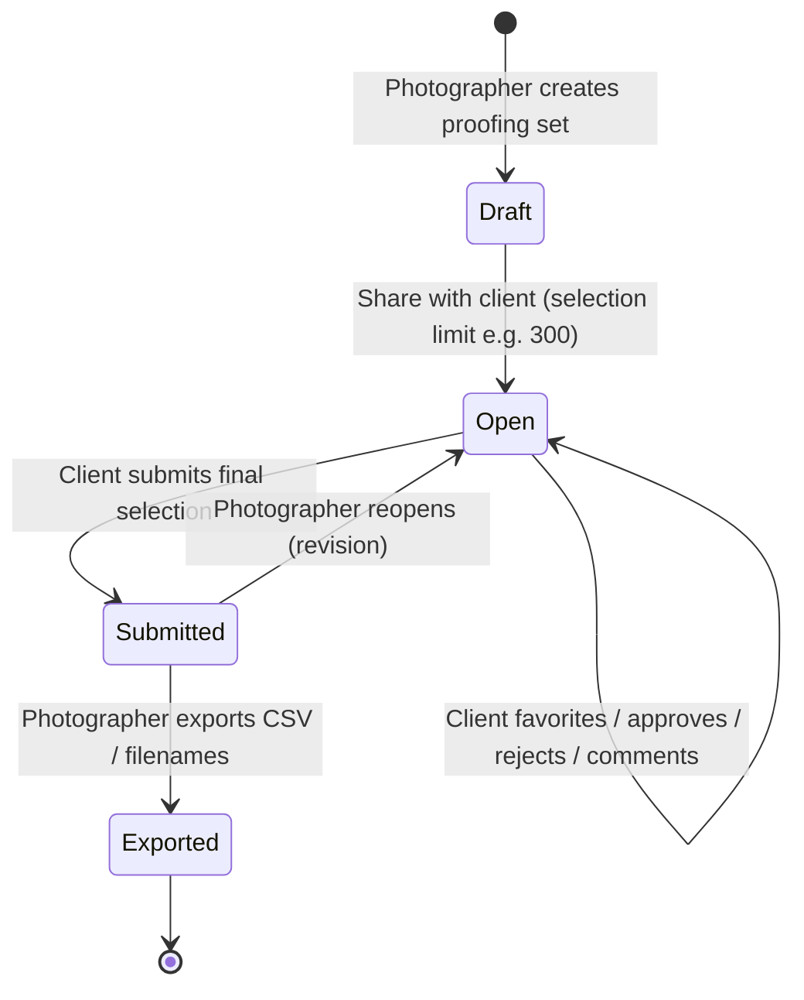
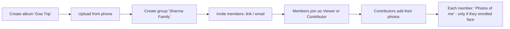
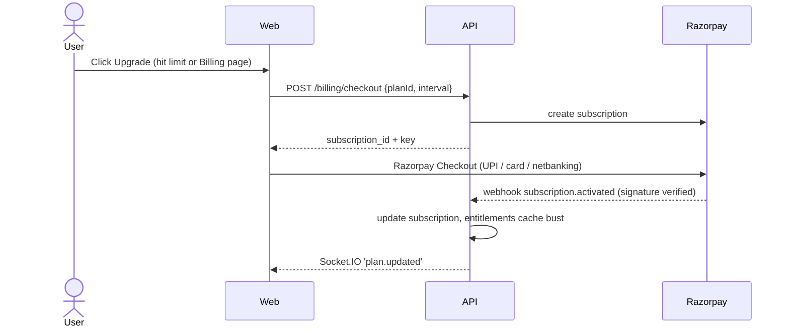

# SnapShare AI — User Journeys

| Field | Value |
|---|---|
| Version | 0.1 (Draft, Batch 1) |
| Related | [PRD.md](PRD.md), [SCREEN_INVENTORY.md](SCREEN_INVENTORY.md) |

Each journey lists its steps, the screens involved (IDs from SCREEN_INVENTORY), the system behaviour, and the failure and edge cases. Steps marked ⚙️ run asynchronously.

---

## J1. Photographer onboarding (Rohan)

| Step | Screen | System behaviour | Edge cases |
|---|---|---|---|
| 1 | PUB-01 Landing | Marketing page, pricing | — |
| 2 | AUTH-01 Sign up | Creates `users`; sends verification email; rate limited | Email already used → generic message (no account enumeration) |
| 3 | AUTH-03 Verify | Single-use token with 24 h TTL | Expired token → resend |
| 4 | ONB-01 Workspace choice | "I'm a photographer/studio" or "Personal use" | Can add the other later |
| 5 | ONB-02 Studio setup | Creates `studios` and an Owner membership; slug uniqueness checked | Reserved slugs (admin, api, www) |
| 6 | ONB-03 Plan | 14-day trial of Photographer Pro by default (proposal) | No card needed for the trial |
| 7 | ST-01 Dashboard | Empty state with checklist: create event → upload → share | — |

## J2. Event creation → bulk upload → processing (core loop)

| Step | Screen | Behaviour | Edge cases |
|---|---|---|---|
| 1 | ST-10 Events list → ST-11 Create event | Name, type, date, venue, albums, AI toggle, watermark preset | Plan event limit reached → upgrade prompt |
| 2 | ST-13 Upload manager | Drag and drop files or folders; client computes SHA-256 in a Web Worker | Non-image files rejected client- and server-side |
| 3 | ST-13 | Shows per-file and overall progress, pause/resume/cancel | Tab closed → resume from the session on return (parts persisted) |
| 4 | ⚙️ | Media worker writes derivatives and extracts EXIF (taken-at, camera) | Corrupt JPEG → photo marked `failed`, shown in "Failed" tab with retry |
| 5 | ⚙️ | AI indexing only if the event has AI enabled and the plan allows it | AI quota exhausted → photos stay browsable; AI resumes after upgrade |
| 6 | ST-12 Event detail | Grid fills in live; counters show uploaded / processed / indexed | Storage quota exceeded mid-upload → stop new files, finish in-flight ones |

## J3. Share event → guest discovers own photos (Priya)

| Step | Screen | Behaviour | Edge cases |
|---|---|---|---|
| 1 | PUB-10 Gallery landing | Resolves the share code to an event; applies branding | Expired link → "Gallery expired, contact photographer" |
| 2 | PUB-11 PIN gate | Rate-limited PIN attempts (5 per 15 min per IP + code) | Lockout message |
| 3 | PUB-12 Gallery | Masonry grid, albums, lazy load | 10k+ photos → virtualized list |
| 4 | PUB-13 Consent | Versioned consent text (EN + HI); explicit checkbox; links to policy | Under-18 → "Ask a parent" path; no selfie capture for declared minors |
| 5 | PUB-14 OTP | Creates a lightweight guest identity (open question in PRD) | OTP abuse → rate limit + captcha |
| 6 | PUB-15 Selfie | Camera capture or upload; client checks for a single face, lighting, size | No face or several faces → guidance to retake |
| 7 | ⚙️ | Embeds the selfie and searches Qdrant filtered to `eventId` only | No match → "No confident matches. Browse albums instead." Never shows low-confidence guesses as certain |
| 8 | PUB-16 My matches | Results with "Not me" feedback per photo | "Not me" removes the photo and improves the threshold |
| 9 | PUB-17 Download | Downloads respect gallery settings (web size or original, watermark) | Downloads disabled → view only |
| 10 | AUTH-01 | Optional free account; matches move to "My Event Photos" | — |

**Consent and retention defaults (proposal):** the selfie image is deleted right after embedding. The guest's embedding is kept until the event's gallery expires or for 90 days, whichever comes first, unless the guest saves it to an account.

## J4. Client proofing (Rohan + couple)

| Step | Screen | Behaviour | Edge cases |
|---|---|---|---|
| 1 | ST-20 Proofing setup | Choose album(s), selection limit, deadline, client emails | — |
| 2 | PUB-20 Proofing gallery | Client-only access via invite link + OTP; heart/approve/reject; comments per photo | Two partners selecting at once → shared selection, live updates through Socket.IO |
| 3 | PUB-20 | Counter "212 / 300 selected" | Over the limit → blocked with a message |
| 4 | PUB-21 Submit | Confirmation, then the selection is locked | — |
| 5 | ST-21 Proofing review | See selections and comments; reopen; export | Export formats: CSV, Lightroom filename list, zip of selected images |

## J5. Studio team management (Meera)

| Step | Screen | Behaviour |
|---|---|---|
| 1 | ST-40 Team | Invite by email with a role (Admin, Editor, Uploader, Viewer) |
| 2 | Email → AUTH-01/02 | Invitee signs up or logs in; membership is created on acceptance |
| 3 | Account switcher | Invitee now sees "Meera Studio" alongside their own workspace |
| 4 | ST-40 | Change role, remove member (sessions for that tenant are revoked), view the member's activity (audit log) |
| Edge | — | Team seat limit from plan entitlements; you cannot remove the last Owner; ownership transfer needs re-authentication |

## J6. Personal album + family sharing (Sharma family)

| Step | Screen | Edge cases |
|---|---|---|
| 1 | ME-10 Albums → ME-11 Album detail | Free plan storage limit |
| 2 | ME-12 Upload (mobile) | Background upload on mobile web is limited, so the tab must stay open. PWA improves this. |
| 3 | ME-20 Groups | Group owner pays (storage counts against the owner, proposal) |
| 4 | ME-21 Invite | Link expiry; revoke link |
| 5 | ME-30 My Photos | Only shows matches within albums the user can access. Never matches across unrelated groups. |
| Minors | — | Parents can add a child "face profile" with guardian consent. **Needs owner decision (Batch 4 gaps).** |

## J7. Face consent lifecycle (any user)

| Action | Screen | System behaviour |
|---|---|---|
| Grant | PUB-13 / ME-40 Privacy | `consents` record: version, scope, timestamp, method, hashed IP/user agent |
| View | ME-40 | Lists every scope with active consent (events, studios, personal) |
| Revoke | ME-40 | Immediately stops matching. ⚙️ Deletes embeddings from Qdrant and face profile records within 24 h. Audit log entry, confirmation email |
| Consent version change | Next visit | User asked to re-consent. Matching paused until they do |
| Account deletion | ME-50 | 7-day grace period, then hard delete of photos, derivatives, biometrics and personal data. Billing records keep the legally required fields only |

## J8. Subscription upgrade (Razorpay primary)

| Case | Behaviour |
|---|---|
| Payment success | Entitlements apply immediately; GST invoice emailed |
| Webhook delayed | UI shows "Activating..." and polls; never grants the plan from the client callback alone |
| Payment failed on renewal | Grace period of 7 days (proposal) → read-only mode → no deletion for 30 days → final warning |
| Downgrade with usage over the new limits | Allowed at period end; uploads blocked until usage fits; data is not auto-deleted |
| Cancel | Active until period end |

## J9. Super admin — incident triage

| Step | Screen | Behaviour |
|---|---|---|
| 1 | AD-01 Dashboard | Alert: AI queue backlog above 50k |
| 2 | AD-30 Queues | Inspect queue depth, failed jobs, DLQ; retry or purge with a reason (audited) |
| 3 | AD-31 AI/GPU | GPU utilization, inference latency per model version; roll back the model version |
| 4 | AD-10 Accounts | Find the studio causing the spike; apply a temporary rate limit |
| 5 | AD-40 Audit logs | Every admin action recorded |

## J10. Abuse report

| Step | Screen | Behaviour |
|---|---|---|
| 1 | PUB-12 "Report" | Anyone can report a gallery or photo with a reason |
| 2 | AD-20 Moderation queue | Admin reviews; can hide the photo, suspend the gallery, or contact the studio |
| 3 | — | Reporter gets an acknowledgement; studio is notified; all actions audited |
